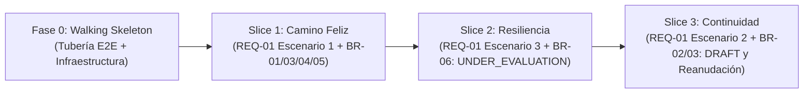

# ADR-0002: Estrategia de Construcción e Integración Incremental (Híbrido Walking Skeleton + Vertical Slices)

Autores:
 - @KevinVerjan
 - @Estebandido-exe
 - @josuarezvi
 - @juacortesva

Fecha: 2026-11-05

## Estado

Aceptado

## Contexto

El proyecto "Asesor Financiero Personal" cuenta con una arquitectura desacoplada y políglota definida en `ADR-0001` (Frontend en React/TypeScript, Backend en Python/FastAPI con arquitectura modular por capas y Base de Datos PostgreSQL externa `g1-team-5-db`, desplegados con Docker en la VM `CentOS Stream 10` bajo `/opt/projects-g1/team-5`) y con un diseño detallado e interactivo especificado en `01_Architectural_and_Detailed_Design.md`, `02_Interaction_and_Data_Design.md` y los contratos `docs/contracts/01..12`.

Antes de codificar la totalidad del requerimiento `REQ-01` (*Categorización Inicial de Situación y Hábitos Financieros*), el equipo debe definir la estrategia de construcción e integración del software. Existen tres riesgos principales si el desarrollo se aborda de forma desordenada:

1. **Riesgo de integración tardía (Desarrollo por capas horizontales aisladas):** Si una parte del equipo construye primero todas las tablas y repositorios, otra construye todos los servicios y otra construye las pantallas de React por separado, los errores de integración (CORS, serialización de tipos `Decimal`, contratos JSON `camelCase`/`snake_case` y autenticación por `userId`) solo se descubrirán al final al intentar unir las piezas.
2. **Riesgo de colisión inicial en el repositorio:** Si los cuatro integrantes intentan programar funcionalidades de negocio completas desde el primer commit sin tener una estructura base conectada, chocarán configurando simultáneamente FastAPI, SQLAlchemy, Alembic, Vite y Docker.
3. **Necesidad de entregas funcionales verificables por escenario:** El requerimiento `REQ-01` está estructurado en tres escenarios de aceptación claramente diferenciados (Escenario 1: Categorización exitosa; Escenario 2: Abandono y reanudación en borrador `DRAFT`; Escenario 3: Falla de cálculo y categoría provisional `UNDER_EVALUATION`). Se requiere poder demostrar y probar cada flujo de extremo a extremo conforme avanza la construcción.

## Decisión

Adoptamos una **estrategia híbrida secuencial** compuesta por dos fases de ejecución: **primero un *Walking Skeleton* (Esqueleto Caminante)** para dejar operativa toda la tubería tecnológica de extremo a extremo, e **inmediatamente después una construcción basada en *Vertical Slices* (Cortes Verticales)** alineados uno a uno con los escenarios de aceptación de `REQ-01`.

---

## Orden de Ejecución (Qué va primero y qué va después)

### Fase 0 (Lo que va primero): Walking Skeleton

Antes de implementar las fórmulas de ponderación o las reglas de negocio completas, se construye y despliega en el entorno reproducible y en la **VM del curso (`CentOS Stream 10`, directorio `/opt/projects-g1/team-5`)** un hilo mínimo pero real que atraviesa todas las capas del sistema:

1. **Infraestructura y Conexión a Base de Datos Externa (`g1-team-5-db`):** Configuración de `docker-compose.yml` y los respectivos `Dockerfile` únicamente para **backend (FastAPI)** y **frontend (React/Vite)** (sin contenedor local de PostgreSQL), definición de `DATABASE_URL` en `.env` (`.env.example`) para conectar SQLAlchemy en `backend/src/core/database.py` al servidor **PostgreSQL externo provisto por la cátedra (`g1-team-5-db`)**, saneamiento previo de tablas residuales y `alembic_version` en `g1-team-5-db`, e inicialización de migraciones con Alembic creando el esquema base (`client`, `survey`, `question`, `answer`, `financial_profile`).
2. **Hilo Conductor en Backend:** Creación de la estructura de carpetas modular (`survey/` y `categorization/`), dependencia de contexto de autenticación (`user_id` / `userId` en API) y un endpoint inicial conectado a través de `Router -> Service -> Repository -> g1-team-5-db`.
3. **Contrato y Generación de Tipos:** Verificación de la especificación OpenAPI en `/docs` y ejecución del script `openapi-typescript` en el frontend para comprobar que los esquemas Pydantic (con `Decimal` y alias `camelCase`) generan interfaces TypeScript válidas.
4. **Hilo Conductor en Frontend y Pruebas:** Pantalla base en React/Vite que consume el endpoint del backend mostrando el resultado en pantalla, junto con la ejecución exitosa de una primera prueba automatizada en `pytest`.

* **Criterio de salida de la Fase 0:** Cualquier integrante del equipo puede clonar el repositorio, configurar `.env` con `DATABASE_URL` hacia `g1-team-5-db`, levantar los contenedores de backend y frontend (`docker-compose.yml`), ejecutar `pytest` en verde y ver una petición real viajando desde React hasta `g1-team-5-db` y de regreso (tanto en desarrollo como en la VM `CentOS Stream 10`, `/opt/projects-g1/team-5`).

---

### Fase 1 en adelante (Lo que va después): Vertical Slices por Escenario de Negocio

Una vez completado el *Walking Skeleton*, queda prohibido desarrollar por capas horizontales aisladas. Todo el desarrollo subsecuente se divide en **Cortes Verticales (*Vertical Slices*)** autocontenidos que atraviesan UI, Router, Service/Engine, Repository, Base de Datos y Pruebas:

#### Slice 1: Cuestionario Completo y Categorización Exitosa (`REQ-01` — Escenario 1 + `BR-01`, `BR-03`, `BR-04`, `BR-05`)
* **Qué incluye:**
  * **Datos y Backend (`survey`):** Carga del catálogo de hasta 10 preguntas parametrizadas (`BR-01`), recepción de respuestas obligatorias completas y transición de la encuesta al estado `COMPLETED` (`complete_survey` / `completeSurvey`, `BR-03`).
  * **Dominio y Backend (`categorization`):** Implementación de `ScoringEngine.calculate_score` usando aritmética exacta `Decimal`, implementación de `ScoringEngine.determine_category` incluyendo la regla de desempate al menor riesgo en el umbral (`BR-05`), y persistencia del perfil vigente en `financial_profile` con estado `COMPLETED` (`BR-04`).
  * **Frontend:** Interfaz del cuestionario que permite responder las preguntas obligatorias, enviar la encuesta y visualizar la pantalla de confirmación con la categoría asignada (`CONSERVATIVE`, `MODERATE` o `AGGRESSIVE`) y el resumen derivado del plan.
  * **Pruebas:** Pruebas unitarias de `ScoringEngine` (incluyendo casos de borde en umbrales para `BR-05`) y prueba de integración del flujo principal de `evaluate_profile`.

#### Slice 2: Tolerancia a Fallos y Categoría Provisional (`REQ-01` — Escenario 3 + `BR-06`)
* **Qué incluye:**
  * **Backend (`categorization`):** Implementación del manejo de excepciones (`try/except`) en `CategorizationService.evaluate_profile`, registro seguro de errores técnicos sin exponer datos sensibles del usuario en logs, y guardado del perfil con categoría provisional `UNDER_EVALUATION`, `evaluation_status = ERROR` y `total_score = null` (`BR-06`, propagando `EvaluationPersistenceError` ante fallo doble).
  * **Frontend:** Manejo de la respuesta con estado `ERROR` en la vista de resultados, mostrando el aviso de falla temporal al cliente con su categoría provisional "En Evaluación" y habilitando el acceso al panel principal sin bloquearlo con una pantalla de error 500.
  * **Pruebas:** Pruebas unitarias y de integración inyectando fallos simulados en el motor de cálculo o en la persistencia para verificar que el contrato devuelve `EvaluationResult` con `UNDER_EVALUATION` y estado `ERROR`.

#### Slice 3: Abandono Parcial y Reanudación de Borrador (`REQ-01` — Escenario 2 + `BR-02`, `BR-03`)
* **Qué incluye:**
  * **Datos y Backend (`survey`):** Garantía del invariante de a lo sumo un borrador (`DRAFT`) activo por `client_id` (`BR-02`), implementación de `SurveyManager.save_answer` (validando que una encuesta `COMPLETED` sea inmutable y rechace modificaciones con `InvalidStateError` según `BR-03`) e implementación de `SurveyManager.resume_survey` junto con `SurveyRepository.find_draft_by_user_id`.
  * **Frontend:** Guardado progresivo de respuestas durante el diligenciamiento del cuestionario y detección automática de borrador existente al reingresar, posicionando al cliente en la primera pregunta obligatoria pendiente sin perder sus respuestas previas.
  * **Pruebas:** Pruebas de integración verificando el guardado progresivo, la recuperación exacta de respuestas al reanudar y el rechazo de `save_answer` cuando la encuesta ya fue cerrada (`COMPLETED`).

## Alternativas consideradas

- **Alternativa A: Desarrollo tradicional por capas horizontales (Database-First o Backend-First completo):** Construir primero el 100% de la base de datos, luego el 100% del backend para todos los escenarios y, al final, conectar el frontend en React.
  - *Por qué se descartó:* Retrasa la validación de la integración entre React/TypeScript y FastAPI hasta el final, impide mostrar funcionalidad completa de usuario en revisiones intermedias y aumenta el riesgo de retrabajo si un contrato de interfaz resulta incómodo para la UI.
- **Alternativa B: Vertical Slices puros desde el minuto cero (sin Walking Skeleton previo):** Dividir al equipo desde el primer día para programar el Slice 1 y el Slice 3 en paralelo sin haber creado antes el esqueleto base.
  - *Por qué se descartó:* Sin una configuración base común de base de datos, sesiones de SQLAlchemy, estructura de carpetas, linters y cliente HTTP en React, cada subequipo resolvería la infraestructura de manera distinta, generando código duplicado y conflictos graves al integrar las ramas.
- **Alternativa C: Walking Skeleton extendido a todos los módulos antes de poner lógica:** Crear endpoints falsos (*mocks*) para todas las operaciones posibles del sistema antes de programar la primera regla de negocio.
  - *Por qué se descartó:* Retrasa innecesariamente la entrega de valor real del negocio (como el motor matemático `ScoringEngine` y la regla `BR-05`). El *Walking Skeleton* debe ser mínimo y servir únicamente para abrir el camino técnico al primer *Vertical Slice*.

## Consecuencias

### Positivas
- **Desriesgado técnico inmediato:** El *Walking Skeleton* valida desde el inicio los puntos de fricción del `ADR-0001` (conexión a `g1-team-5-db` vía `DATABASE_URL`, tipos `Decimal`, generación de tipos con `openapi-typescript`, contenedores Docker de backend/frontend y CORS).
- **Trazabilidad directa con `REQ-01`:** Cada *Vertical Slice* corresponde exactamente a un criterio de aceptación (`AC-01.1`, `AC-01.2`, `AC-01.3`) y a los diagramas de secuencia de `02_Interaction_and_Data_Design.md`, facilitando las demostraciones y la evaluación del proyecto.
- **Paralelismo limpio tras el Slice 1:** Una vez establecido el flujo base, los escenarios de resiliencia (Slice 2 en `categorization/`) y de borrador/reanudación (Slice 3 en `survey/`) tocan módulos distintos y pueden desarrollarse en paralelo sin pisarse el código.
- **Software siempre funcional:** Al terminar cada *Slice*, el sistema en la rama principal es desplegable y entregable de extremo a extremo.

### Negativas y Mitigaciones (Trade-offs)
- **Sincronización inicial en la Fase 0:** Durante la construcción del *Walking Skeleton*, el equipo no puede dispersarse a programar vistas finales hasta que el esqueleto esté fusionado en la rama principal. *Mitigación:* Mantener el alcance del *Walking Skeleton* estrictamente limitado a la infraestructura base y un único flujo de conectividad, dividiendo su montaje en tareas concretas (Docker backend/frontend y saneamiento de `g1-team-5-db`, esqueleto FastAPI, esqueleto React y pipeline de pruebas).
- **Migraciones incrementales o ajuste de contratos entre Slices:** Al avanzar del Slice 1 al Slice 3 pueden requerirse ajustes menores en índices o esquemas DTO. *Mitigación:* Apoyarse en el modelo de datos ya diseñado en `02_Interaction_and_Data_Design.md` al crear la migración inicial de Alembic, dejando las tablas listas para soportar los tres cortes verticales.
