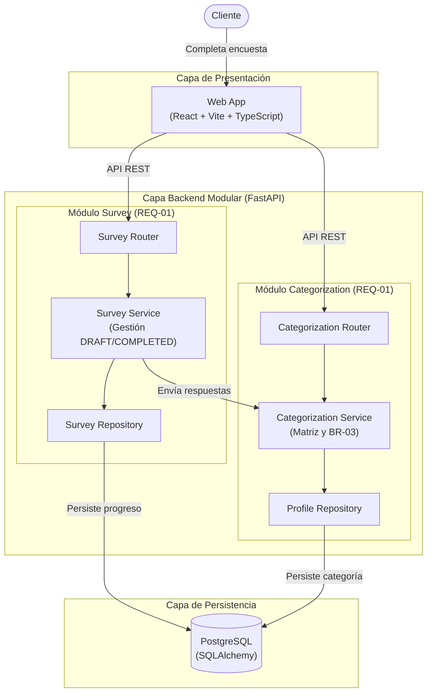
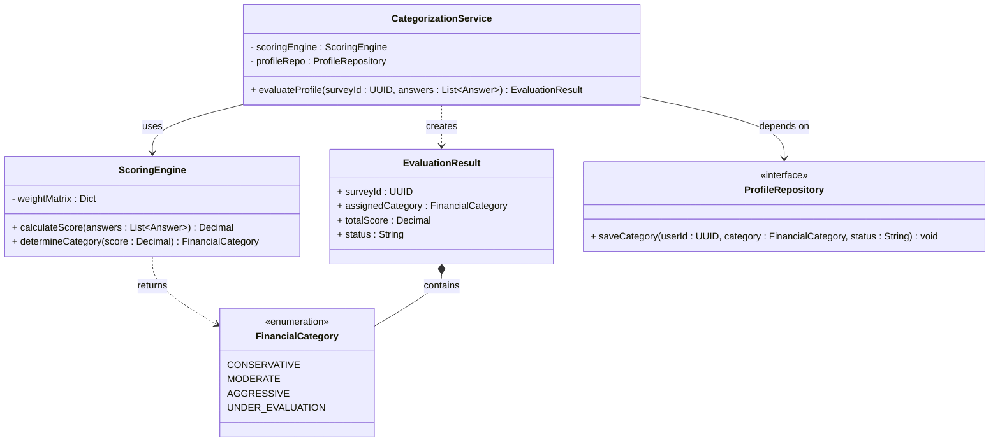
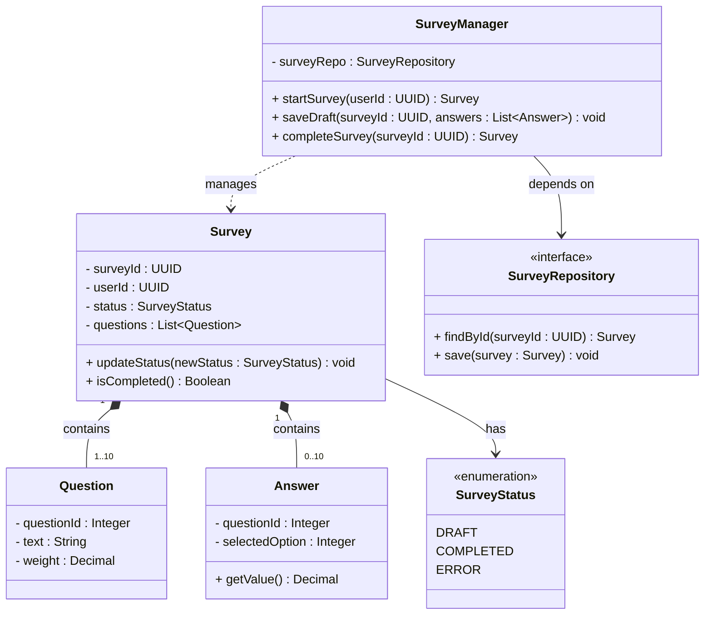

<!--
HOW TO USE THIS TEMPLATE
------------------------
1. Copy this file to docs/design/01_Architectural_and_Detailed_Design.md in your team repository.
2. This is v1.0 of work you already started: your Class 11 "Architectural Hypothesis v0.1"
   and your Class 12 "Detailed Design v0.1". Extend them to your whole system. Do not restart.
3. Use YOUR project. Generic examples (e-commerce, food delivery, banking, library) are
   only reference material and cannot be submitted as project artifacts.
4. Fill in every section. If something genuinely does not apply, write "N/A: reason".
   Never invent content to fill a blank.
5. Every diagram needs the table or argument that explains it. A diagram records design
   decisions. It does not create them.
6. Diagrams: Mermaid is preferred because it renders on GitHub. PlantUML or another tool is
   accepted if the exported image is committed and embedded in this file.
   Optionally, also add a JPG of each diagram in docs/design/diagrams/ (the Markdown prevails if they differ).
7. Read Design_Deliverable_1_Example.md for the expected level of detail. Do not copy it.
-->

# Asesor Financiero Personal — Architectural & Detailed Design v1.0

|                   |                                                                                                                                            |
| ----------------- | ------------------------------------------------------------------------------------------------------------------------------------------ |
| **Team**    | Grupo 5                                                                                                                                    |
| **Members** | Esteban David Suárez<br />Juan David Cortés<br />Joel Felipe Suárez<br />Kevin Facid Verjan                                             |
| **Status**  | Ready for review                                                                                                                           |
| **Date**    | 2026-10-17                                                                                                                                 |
| **Inputs**  | `docs/requirements/REQ-01.md`, `docs/decisions/ADR-0001.md`, Architectural Hypothesis v0.1 (Class 11), Detailed Design v0.1 (Class 12) |

---

## 1. System Overview & Design Drivers

**System purpose**

> El sistema permite a los usuarios descubrir y registrar su perfil financiero y evaluar su riesgo mediante un cuestionario interactivo el cual arroja un proyección y plan personalizado. La estructura debe garantizar la integridad de los datos financieros y ofrecer una experiencia de usuario durante la incorporación.

**Requirements that shape the structure** *(the ones that most influence the design, not all of them)*

| Requirement / Use Case ID                          | Why it shapes the structure                                                                                                                                                                                                                          | Quality attribute, constraint or business rule involved                                                                                                                                                                                                               |
| -------------------------------------------------- | ---------------------------------------------------------------------------------------------------------------------------------------------------------------------------------------------------------------------------------------------------- | --------------------------------------------------------------------------------------------------------------------------------------------------------------------------------------------------------------------------------------------------------------------- |
| **REQ-01 / Catalogar Situación Financiera** | Obliga a separar la lógica de gestión de la encuesta (guardado temporal, reanudación) de la lógica matemática de evaluación (matriz de ponderación). Esto justifica la división del backend en los módulos `Survey` y `Categorization`. | **BR-01:** Asignar categoría antes de generar el plan.**BR-02:** Máximo 10 preguntas (límite de tiempo).**BR-03:** Desempate por categoría de menor riesgo en los límites.**Constraint:** Sin integraciones con APIs bancarias externas. |
| **ADR-0001 / Stack Tecnológico**            | Define que la arquitectura debe ser una API REST desacoplada del cliente web, aplicando un patrón por capas (`Routers -> Services -> Repositories`) para asegurar la mantenibilidad en un semestre académico.                                    | **Restricción de tiempo:** Entregas en 15 semanas.**Requisito arquitectónico:** Desacoplamiento claro entre cliente web y servidor.**Calidad:** Precisión numérica estricta (uso de `decimal.Decimal` y PostgreSQL).                          |

---

## 2. Architectural Design

### 2.1 System Context & Boundary

| Outside the system | Type (actor / external system / hardware) | How the system interacts with it                                                                                                                                                                                  |
| ------------------ | ----------------------------------------- | ----------------------------------------------------------------------------------------------------------------------------------------------------------------------------------------------------------------- |
| **Cliente**  | Actor                                     | Interactúa con la interfaz web para registrarse, completar la encuesta breve de hábitos financieros (REQ-01), reanudar una encuesta abandonada en estado borrador, y visualizar su categoría inicial asignada. |

### 2.2 Components, Responsibilities & Capabilities

Cover the principal functional scope of your whole system.



| Component                        | Main responsibility                                                                                                         | Requirements / use cases supported | Provided capabilities                                               | Required capabilities                                                               | Main dependencies                         |
| -------------------------------- | --------------------------------------------------------------------------------------------------------------------------- | ---------------------------------- | ------------------------------------------------------------------- | ----------------------------------------------------------------------------------- | ----------------------------------------- |
| **Web App**                | Proveer la interfaz de usuario interactiva para el registro, la encuesta y la visualización de la categoría.              | REQ-01 (Escenarios 1, 2 y 3)       | Interfaz gráfica (UI), gestión de formularios en el cliente.      | Consumir API REST de encuestas, Consumir API REST de categorización.               | Survey Router, Categorization Router      |
| **Survey Router**          | Recibir y validar las peticiones HTTP relacionadas con la encuesta (inicio, guardado de respuestas).                        | REQ-01 (Escenario 2)               | Endpoints HTTP para guardar progreso (`DRAFT`) y enviar encuesta. | Ejecutar la lógica del Survey Service.                                             | Survey Service                            |
| **Survey Service**         | Gestionar el ciclo de vida de la encuesta (mantener estado `DRAFT` si se abandona) y preparar los datos para evaluación. | REQ-01 (Escenario 1 y 2)           | Lógica de negocio para el manejo de estados borrador/completado.   | Persistir respuestas parciales, Enviar respuestas finales al evaluador.             | Survey Repository, Categorization Service |
| **Survey Repository**      | Aislar y ejecutar las operaciones de base de datos para las respuestas de la encuesta.                                      | REQ-01                             | Contrato de acceso a datos (`ISurveyRepository`).                 | Conexión a la base de datos.                                                       | PostgreSQL                                |
| **Categorization Router**  | Recibir las peticiones HTTP para evaluar el perfil financiero.                                                              | REQ-01 (Escenario 1 y 3)           | Endpoints HTTP para iniciar evaluación.                            | Ejecutar la lógica del Categorization Service.                                     | Categorization Service                    |
| **Categorization Service** | Aplicar la matriz de ponderación y la regla de desempate (BR-03) para asignar la categoría inicial.                       | REQ-01 (Regla BR-03, Escenario 3)  | Cálculo matemático de perfil y categorización.                   | Guardar la categoría calculada, Validar respuestas (recibidas del Survey Service). | Profile Repository                        |
| **Profile Repository**     | Aislar y ejecutar las operaciones de base de datos para el perfil y categoría del cliente.                                 | REQ-01 (BR-01)                     | Contrato de acceso a datos (`IProfileRepository`).                | Conexión a la base de datos.                                                       | PostgreSQL                                |
| **PostgreSQL**             | Almacenar de forma persistente y relacional los usuarios, respuestas y categorías con precisión decimal.                  | ADR-0001                           | Persistencia de datos, integridad referencial.                      | N/A                                                                                 | N/A                                       |

---

## 3. Detailed Design

### 3.1 Components selected

| Component                       | Why it was selected (risk, complexity, centrality to the drivers)                                                                                                                                                                                                                                                                                                                                                                                                          |
| ------------------------------- | -------------------------------------------------------------------------------------------------------------------------------------------------------------------------------------------------------------------------------------------------------------------------------------------------------------------------------------------------------------------------------------------------------------------------------------------------------------------------- |
| **Categorization Module** | **Complejidad y Centralidad:** Es el componente más crítico del sistema porque contiene la lógica matemática de la matriz de ponderación y la regla de negocio **BR-03** (asignación conservadora en caso de empate). Además, debe gestionar el escenario de excepción del REQ-01 (asignar la categoría provisional "En Evaluación" si el servicio falla). Un error aquí desvirtúa la propuesta de valor del producto (personalización del plan). |
| **Survey Module**         | **Riesgo de Abandono y Manejo de Estado:** Fue seleccionado porque gestiona el ciclo de vida de la encuesta y la posibilidad de que el usuario abandone el proceso a la mitad. Requiere un diseño cuidadoso para manejar la transición de estado de borrador (`DRAFT`) a completado (`COMPLETED`), garantizando que el usuario pueda reanudar la encuesta exactamente donde la dejó sin perder información.                                                  |

### 3.2 Class Diagram(s)

#### Diagrama A: Módulo de Categorización (`Categorization Module`)



#### Diagrama B: Módulo de Encuesta (`Survey Module`)



### 3.3 Class Responsibilities

| Class                           | Component it belongs to | Responsibility                                                                                                                                                                                      | Key collaborators                |
| ------------------------------- | ----------------------- | --------------------------------------------------------------------------------------------------------------------------------------------------------------------------------------------------- | -------------------------------- |
| **CategorizationService** | Categorization Module   | Orquestar el proceso de evaluación. Recibe la encuesta completada, solicita el cálculo matemático y maneja el escenario de excepción (si falla, asigna estado "En Evaluación" según REQ-01).  | ScoringEngine, ProfileRepository |
| **ScoringEngine**         | Categorization Module   | Aplicar la matriz de ponderación y calcular el puntaje exacto usando `Decimal`. Implementa la regla **BR-03** (si el puntaje está en el límite, asigna la categoría más conservadora). | FinancialCategory                |
| **EvaluationResult**      | Categorization Module   | Transportar el resultado final de la evaluación (puntaje obtenido, categoría asignada y estado del proceso) antes de ser guardado.                                                                | FinancialCategory                |
| **FinancialCategory**     | Categorization Module   | Definir el catálogo cerrado de categorías financieras (Conservador, Moderado, Agresivo, En Evaluación).                                                                                          | N/A (Enumeration)                |
| **ProfileRepository**     | Categorization Module   | Proveer el contrato (interfaz) para persistir la categoría calculada y el estado final en la base de datos, ocultando los detalles de SQLAlchemy.                                                  | PostgreSQL (vía ORM)            |
| **SurveyManager**         | Survey Module           | Coordinar el ciclo de vida de la encuesta. Iniciar la encuesta, guardar el progreso parcial (`DRAFT`) y marcarla como completada (`COMPLETED`).                                                 | Survey, SurveyRepository         |
| **Survey**                | Survey Module           | Mantener el estado actual de la encuesta, agrupar las preguntas y almacenar temporalmente las respuestas del cliente.                                                                               | Question, Answer, SurveyStatus   |
| **Question**              | Survey Module           | Representar una pregunta individual del cuestionario, incluyendo su peso (peso decimal) para la matriz de evaluación.                                                                              | Survey                           |
| **Answer**                | Survey Module           | Almacenar la opción seleccionada por el usuario para una pregunta específica y calcular su valor ponderado.                                                                                       | Question, Survey                 |
| **SurveyStatus**          | Survey Module           | Definir los estados válidos del flujo (DRAFT, COMPLETED, ERROR) para evitar transiciones inválidas.                                                                                               | N/A (Enumeration)                |
| **SurveyRepository**      | Survey Module           | Proveer el contrato (interfaz) para guardar el estado de la encuesta y las respuestas parciales en la base de datos.                                                                                | PostgreSQL (vía ORM)            |

**Nota de diseño sobre Colaboradores:**
Ninguna clase accede directamente a PostgreSQL. Las clases de servicio (`CategorizationService`, `SurveyManager`) solo colaboran con las interfaces de los repositorios (`ProfileRepository`, `SurveyRepository`), garantizando el bajo acoplamiento y el ocultamiento de la información exigidos en el ADR.

### 3.4 Behavior of one key operation

```text
evaluateProfile(surveyId, answers):
    TRY:
        IF answers IS EMPTY:
            THROW InvalidInputError("La encuesta no tiene respuestas")
  
        // 1. Cálculo matemático exacto (usando Decimal según ADR-0001)
        totalScore = ScoringEngine.calculateScore(answers)
  
        // 2. Determinación de categoría (incluye validación interna de BR-03)
        assignedCategory = ScoringEngine.determineCategory(totalScore)
  
        // 3. Persistencia del resultado exitoso
        ProfileRepository.saveCategory(surveyId, assignedCategory, "COMPLETED")
        RETURN EvaluationResult(surveyId, assignedCategory, totalScore, "COMPLETED")

    CATCH Exception as error:
        // Escenario 3 del REQ-01: Falla en el servicio de categorización
        LogError(error)
        provisionalCategory = FinancialCategory.UNDER_EVALUATION
  
        // Se guarda como provisional para permitir el acceso al panel principal
        ProfileRepository.saveCategory(surveyId, provisionalCategory, "ERROR")
        RETURN EvaluationResult(surveyId, provisionalCategory, null, "ERROR")
```

---

## 4. Design Quality — Cohesion, Coupling, Information Hiding

| Question                                                                                               | Your answer, with evidence from your design                                                                                                                                                                                                                                                                                                                                                                                                                        |
| ------------------------------------------------------------------------------------------------------ | ------------------------------------------------------------------------------------------------------------------------------------------------------------------------------------------------------------------------------------------------------------------------------------------------------------------------------------------------------------------------------------------------------------------------------------------------------------------ |
| **Cohesion:** do the responsibilities inside each class or component belong together?            | **Alta cohesión.** La responsabilidad está fuertemente agrupada. Por ejemplo, el `CategorizationService` solo orquesta el proceso y maneja las excepciones; no sabe hacer matemáticas. El cálculo matemático y la regla de desempate (BR-03) viven exclusivamente en `ScoringEngine`. De igual forma, el `SurveyManager` solo se encarga del ciclo de vida de la encuesta (`DRAFT/COMPLETED`) y no se mezcla con la lógica de categorización. |
| **Coupling:** how far does a change in one element spread? Where are the strongest dependencies? | **Bajo acoplamiento.** La dependencia más fuerte es hacia la base de datos, pero está aislada mediante las interfaces `ProfileRepository` y `SurveyRepository`. Si cambia la base de datos o el ORM (SQLAlchemy), solo se modifican las implementaciones de los repositorios, sin afectar a los servicios. Además, la comunicación entre los dos módulos (Survey y Categorization) es unidireccional y a través de contratos bien definidos.       |
| **Information hiding:** what did you keep private or internal, and why?                          | **Ocultamiento efectivo.** La lógica exacta de la matriz de ponderación y la validación del límite para la regla BR-03 están ocultas dentro del `ScoringEngine` (métodos privados o encapsulados). Otros módulos no necesitan saber *cómo* se calcula el puntaje, solo piden el resultado. De igual manera, los detalles de la conexión a PostgreSQL (credenciales, queries SQL) están ocultos detrás de las interfaces de los repositorios.  |

**At least one real finding** (a problem you found in your own design) **and what you changed or would change:**

> **Hallazgo Real (Detectado en la revisión de diseño):** En nuestro primer borrador conceptual, el `CategorizationService` intentaba hacerlo todo: calculaba el puntaje, evaluaba la regla BR-03, y hacía la llamada directa al ORM de la base de datos para guardar el resultado.
>
> **Problema:** Esto rompía la cohesión (mezclaba lógica de negocio con persistencia) y violaba el ADR-0001 (que exige capas separadas). Además, si la base de datos fallaba, el servicio lanzaba un error *500 Internal Server Error* que rompía la aplicación en el frontend, violando el **Escenario 3 del REQ-01**.
>
> **Solución aplicada:** Extraemos la matemática pura a la clase `ScoringEngine` (aumentando la cohesión) y movimos la persistencia a la interfaz `ProfileRepository` (aumentando el ocultamiento de información). Finalmente, implementamos un bloque `TRY/CATCH` en el `CategorizationService` (visto en la sección 3.4) para capturar cualquier fallo de base de datos y asignar la categoría provisional "En Evaluación", garantizando así que el usuario no se quede bloqueado.

---

## 5. Design Decisions & Decision Record

Two decisions are required: one architectural (Class 11 level) and one detailed-design (Class 12 level). Avoid "it is best practice", "it scales" or "it is cleaner" without project evidence.

### Decision A — Architectural

|                                                                          |                                                                                                                                                                                                                                                                                                                                                                                                                                        |
| ------------------------------------------------------------------------ | -------------------------------------------------------------------------------------------------------------------------------------------------------------------------------------------------------------------------------------------------------------------------------------------------------------------------------------------------------------------------------------------------------------------------------------- |
| **Context** (requirement, constraint or problem that motivated it) | El desarrollo está enmarcado en un semestre académico (15 semanas) y exige un desacoplamiento claro entre el cliente y el servidor mediante una API REST. Además, se requiere persistencia relacional con precisión decimal estricta para evitar errores de redondeo en operaciones financieras, y la generación automática de documentación OpenAPI como entregable de la asignatura.                                          |
| **Decision**                                                       | Adoptar un stack tecnológico compuesto por React (Frontend), Python/FastAPI (Backend) y PostgreSQL (BD), aplicando una arquitectura por capas estricta en el backend (`Routers -> Services -> Repositories`).                                                                                                                                                                                                                       |
| **Rationale** (why it is reasonable here)                          | FastAPI genera automáticamente la documentación interactiva (Swagger UI) a partir de los esquemas de Pydantic, cumpliendo con el requisito del curso. El uso de Python (`decimal.Decimal`) y el tipo `NUMERIC` de PostgreSQL garantiza la aritmética exacta requerida para las proyecciones financieras, superando la limitación de punto flotante de JavaScript (evaluado en Node.js).                                        |
| **Trade-off accepted**                                             | Se acepta el cambio de contexto de lenguaje (TypeScript en el frontend y Python en el backend). Para mitigar esto, se utilizarán generadores de tipos automáticos (como `openapi-typescript`) para mantener un contrato de datos fuertemente tipado en ambos extremos. Además, FastAPI no impone la estructura de capas por defecto, por lo que el equipo debe aplicar la disciplina arquitectónica manualmente por convención. |

### Decision B — Detailed design

|                              |                                                                                                                                                                                                                                                                                                                                                                                |
| ---------------------------- | ------------------------------------------------------------------------------------------------------------------------------------------------------------------------------------------------------------------------------------------------------------------------------------------------------------------------------------------------------------------------------ |
| **Context**            | El REQ-01 especifica dos escenarios críticos: el usuario puede abandonar la encuesta a la mitad (requiriendo guardado en estado `DRAFT`), y el servicio de evaluación puede fallar (requiriendo una categoría provisional "En Evaluación" sin bloquear el acceso del usuario al sistema).                                                                                |
| **Decision**           | Delegar la gestión del estado de la encuesta (`DRAFT/COMPLETED`) exclusivamente al `SurveyManager` y encapsular la evaluación matemática en el `CategorizationService`. Si este último falla, en lugar de propagar una excepción HTTP 500, captura el error, asigna la categoría `UNDER_EVALUATION` y persiste el estado como `ERROR` para reintentos futuros. |
| **Rationale**          | Protege la experiencia de usuario (propuesta de valor del REQ-01). Si el usuario abandona, no pierde su progreso. Si el motor de evaluación falla, el usuario aún puede ingresar a la plataforma y ver su panel, cumpliendo con el Escenario 3 del requerimiento y evitando la deserción por fallos técnicos.                                                              |
| **Trade-off accepted** | Se asume una mayor complejidad en el backend al tener que gestionar un estado adicional (`UNDER_EVALUATION`) y lógica de tolerancia a fallos (try/catch). A nivel de negocio, se acepta que el usuario vea un plan genérico temporal hasta que el proceso de categorización se resuelva en segundo plano.                                                                 |

### ADR

La decisión arquitectónica (Decision A) se encuentra formalmente documentada en el registro de decisiones del proyecto.

**ADR file:** `docs/decisions/ADR-0001.md` — records Decision A.

---

## 6. Traceability

| Requirement ID                                    | Use Case                                                    | Component(s)                                                                                     | Class(es)                                                                                                                                                                     |
| ------------------------------------------------- | ----------------------------------------------------------- | ------------------------------------------------------------------------------------------------ | ----------------------------------------------------------------------------------------------------------------------------------------------------------------------------- |
| **REQ-01** (Escenario 1)                    | Categorización exitosa tras completar la encuesta          | Web App, Survey Module, Categorization Module, PostgreSQL                                        | ``SurveyManager`, `Survey`, `Question`, `Answer`, `CategorizationService`, `ScoringEngine`, `EvaluationResult`, `FinancialCategory`, `SurveyRepository`, `ProfileRepository`` |
| **REQ-01** (Escenario 2)                    | Abandono y reanudación de la encuesta (`DRAFT`)          | Web App, Survey Module, PostgreSQL                                                               | `SurveyManager`, `Survey`, `SurveyStatus`, `SurveyRepository`, `Answer`                                                                                             |
| **REQ-01** (Escenario 3)                    | Error de cálculo (Excepción y asignación provisional)    | Categorization Module, PostgreSQL                                                                | `CategorizationService`, `FinancialCategory` (UNDER_EVALUATION), `ProfileRepository`                                                                                    |
| **REQ-01** (BR-03)                          | Desempate por menor riesgo en el límite                    | Categorization Module                                                                            | `ScoringEngine`, `FinancialCategory`                                                                                                                                      |
| **ADR-0001** (Restricción Arquitectónica) | Aplicación de arquitectura por capas y persistencia exacta | Web App, Survey Router, Categorization Router, Survey Repository, Profile Repository, PostgreSQL | *(Afecta la estructura de todos los componentes y el uso de tipos `Decimal` en las clases)*                                                                               |

---

## 7. Optional — AI-Assisted Design Reflection

> Durante la fase de diseño detallado, un asistente de IA sugirió implementar una arquitectura orientada a eventos (utilizando un broker de mensajes como RabbitMQ o Celery) para comunicar el `Survey Module` con el `Categorization Module`. El argumento de la IA era que esto desacoplaría los módulos y evitaría que el usuario tuviera que esperar a que el motor de evaluación terminara para ver su pantalla de confirmación.
>
> **Decisión del equipo:** Rechazamos esta recomendación. Aunque técnicamente es una solución robusta, violaba la restricción de tiempo y la decisión arquitectónica registrada en el **ADR-0001**, el cual descarta explícitamente la sobrecarga operacional de microservicios o infraestructura compleja (como Docker y colas de mensajes) para un proyecto de un solo semestre.
>
> **Lo que sí adoptamos:** En su lugar, mantuvimos una comunicación síncrona entre los módulos, pero aplicamos la sugerencia de la IA en el manejo de errores. La IA nos ayudó a estructurar el bloque `TRY/CATCH` en el `CategorizationService` para que, si la evaluación falla, en lugar de lanzar un error 500, asigne la categoría provisional `UNDER_EVALUATION`. Esto cumple con el **Escenario 3 del REQ-01** (permitir el acceso al panel principal incluso si falla el servicio) sin agregar complejidad innecesaria a la infraestructura.

---

## 8. Consistency Checklist

- [X] Every component in the diagram appears in the responsibilities table, and the other way around.
- [X] Every class belongs to an identifiable component.
- [X] Components are named by responsibility, not technology.
- [X] Nothing inside the system boundary is something you do not control.
- [X] Provided and required capabilities match across components (what one requires, another provides).
- [X] Both decisions name a real cost or limitation, and at least one has an ADR.
- [X] The traceability table has no empty rows and no orphan components or classes.
- [X] Diagrams render correctly on GitHub (or the exported images are embedded).
