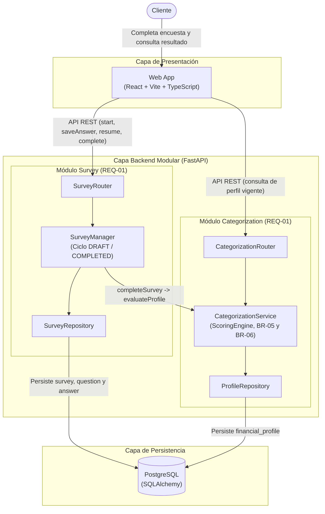
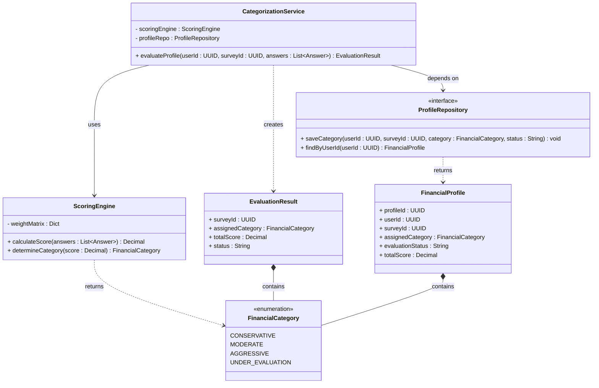
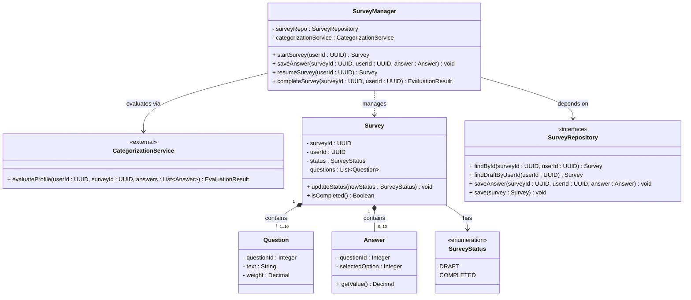

# Asesor Financiero Personal — Architectural & Detailed Design v1.1

|                   |                                                                                                                                            |
| ----------------- | ------------------------------------------------------------------------------------------------------------------------------------------ |
| **Team**    | Grupo 5                                                                                                                                    |
| **Members** | Esteban David Suárez<br />Juan David Cortés<br />Joel Felipe Suárez<br />Kevin Facid Verjan                                             |
| **Status**  | Aligned with `REQ-01` & Interaction/Data Design v1.2                                                                                       |
| **Date**    | 2026-10-17 (updated 2026-11-12)                                                                                                            |
| **Inputs**  | `docs/req/REQ-01.md`, `docs/adr/adr-0001.md`, `docs/design/02_Interaction_and_Data_Design.md`, Architectural Hypothesis v0.1 (Class 11), Detailed Design v0.1 (Class 12) |

---

## 1. System Overview & Design Drivers

**System purpose**

> El sistema permite a los usuarios descubrir y registrar su perfil financiero mediante un cuestionario interactivo breve que asigna una categoría inicial (`CONSERVATIVE`, `MODERATE`, `AGGRESSIVE` o provisional `UNDER_EVALUATION`). La estructura debe garantizar la integridad de los datos financieros y ofrecer una experiencia de usuario fluida durante la incorporación.

**Requirements that shape the structure** *(the ones that most influence the design, not all of them)*

| Requirement / Use Case ID                          | Why it shapes the structure                                                                                                                                                                                                                          | Quality attribute, constraint or business rule involved                                                                                                                                                                                                               |
| -------------------------------------------------- | ---------------------------------------------------------------------------------------------------------------------------------------------------------------------------------------------------------------------------------------------------- | --------------------------------------------------------------------------------------------------------------------------------------------------------------------------------------------------------------------------------------------------------------------- |
| **REQ-01 / Catalogar Situación Financiera** | Obliga a separar la lógica de gestión del ciclo de encuesta (guardado progresivo en `DRAFT`, reanudación y cierre inmutable `COMPLETED`) de la lógica matemática de evaluación (matriz de ponderación y desempate). Esto justifica la división del backend en los módulos `survey` y `categorization`. Además, el riesgo de filtración de datos del cliente exige validar la propiedad (`userId` en dominio / `client_id` en BD) en servicio y persistencia. | **BR-01:** Máximo 10 preguntas activas con peso no negativo.<br>**BR-02:** A lo sumo un borrador `DRAFT` por cliente.<br>**BR-03:** Cierre en `COMPLETED` (inmutable) solo con todas las obligatorias respondidas.<br>**BR-04:** Categoría única vigente por cliente.<br>**BR-05:** Desempate conservador (`<=`) en umbrales.<br>**BR-06:** Categoría provisional `UNDER_EVALUATION` ante fallo de evaluación.<br>**Constraint:** Sin integraciones con APIs bancarias externas.<br>**Calidad:** Seguridad, privacidad (sin PII, respuestas ni puntajes en logs) e integridad de datos. |
| **ADR-0001 / Stack Tecnológico**            | Define que la arquitectura debe ser una API REST desacoplada del cliente web, aplicando un patrón por capas (`router` -> `service` -> `engine`/`repository` -> `models`) para asegurar la mantenibilidad en un semestre académico.                                    | **Restricción de tiempo:** Entregas en 15 semanas.<br>**Requisito arquitectónico:** Desacoplamiento claro entre cliente web y servidor.<br>**Calidad:** Precisión numérica estricta (uso de `decimal.Decimal` y `NUMERIC` en PostgreSQL).                          |

---

## 2. Architectural Design

### 2.1 System Context & Boundary

| Outside the system | Type (actor / external system / hardware) | How the system interacts with it                                                                                                                                                                                  |
| ------------------ | ----------------------------------------- | ----------------------------------------------------------------------------------------------------------------------------------------------------------------------------------------------------------------- |
| **Cliente**  | Actor                                     | Interactúa con la interfaz web para completar la encuesta breve de hábitos financieros (`REQ-01`), reanudar un borrador abandonado en estado `DRAFT` y visualizar su categoría inicial asignada. |

### 2.2 Components, Responsibilities & Capabilities

Cover the principal functional scope of your whole system.



| Component                        | Main responsibility                                                                                                         | Requirements / use cases supported | Provided capabilities                                               | Required capabilities                                                               | Main dependencies                         |
| -------------------------------- | --------------------------------------------------------------------------------------------------------------------------- | ---------------------------------- | ------------------------------------------------------------------- | ----------------------------------------------------------------------------------- | ----------------------------------------- |
| **Web App**                | Proveer la interfaz de usuario interactiva para responder la encuesta, reanudar borradores y visualizar la categoría inicial asignada. | `REQ-01` (Escenarios 1, 2 y 3)       | Interfaz gráfica (UI), gestión de formularios y cálculo visual de la primera pregunta pendiente. | Consumir API REST de encuestas y consulta de perfil.                                | `SurveyRouter`, `CategorizationRouter`      |
| **SurveyRouter**          | Recibir y validar peticiones HTTP de encuesta (`startSurvey`, `saveAnswer`, `resumeSurvey`, `completeSurvey`), inyectando el `userId` autenticado mediante `Depends(getCurrentUser)` y traduciendo excepciones de dominio a HTTP. | `REQ-01` (Escenarios 1, 2 y 3)               | Endpoints HTTP para iniciar encuesta, guardar respuestas progresivamente (`DRAFT`), reanudar borrador y enviar encuesta. | Ejecutar la lógica de `SurveyManager`, validar la sesión del cliente.               | `SurveyManager`                            |
| **SurveyManager**         | Gestionar el ciclo de vida de la encuesta (`BR-01`, `BR-02`, `BR-03`), validar estado `DRAFT` y propiedad por `userId`, coordinar el guardado progresivo (`saveAnswer`) y delegar la evaluación tras cerrar en `COMPLETED`. | `REQ-01` (Escenarios 1, 2 y 3; `BR-01`..`BR-03`) | Lógica de negocio para `DRAFT`/`COMPLETED`, reanudación del único borrador del cliente y disparo de evaluación. | Persistir encuesta y respuestas, localizar borrador por `userId`, invocar evaluación. | `SurveyRepository`, `CategorizationService` |
| **SurveyRepository**      | Aislar y ejecutar las operaciones de base de datos sobre `survey`, `question` y `answer`, restringiendo consultas y modificaciones al propietario (`client_id = userId`). | `REQ-01`                             | Contrato de acceso a datos (`SurveyRepository`).                 | Conexión a la base de datos.                                                       | PostgreSQL                                |
| **CategorizationRouter**  | Exponer los endpoints HTTP de consulta del perfil financiero vigente del usuario autenticado (`findByUserId`), validando sesión. En `REQ-01`, la evaluación tras enviar la encuesta se dispara internamente vía `SurveyRouter` -> `SurveyManager` -> `CategorizationService`. | `REQ-01` (`BR-04`, consulta de perfil)           | Endpoints HTTP para consultar la categoría vigente del cliente.     | Consultar perfil vigente vía `CategorizationService`, validar la sesión del cliente. | `CategorizationService`                    |
| **CategorizationService** | Orquestar la evaluación síncrona de respuestas mediante `ScoringEngine` (`BR-05`), persistir la categoría vigente (`BR-04`) y gestionar el fallback síncrono (`BR-06` y `EvaluationPersistenceError` ante fallo doble). | `REQ-01` (`BR-04`, `BR-05`, `BR-06`, Escenario 3)  | Orquestación de cálculo de perfil, categorización y tolerancia a fallos. | Guardar categoría definitiva o provisional (`UNDER_EVALUATION`).                    | `ScoringEngine`, `ProfileRepository`        |
| **ProfileRepository**     | Aislar y ejecutar las operaciones de base de datos sobre `financial_profile`, restringiendo consultas y modificaciones al propietario (`client_id = userId`). | `REQ-01` (`BR-04`, `BR-06`)                     | Contrato de acceso a datos (`ProfileRepository`).                | Conexión a la base de datos.                                                       | PostgreSQL                                |
| **PostgreSQL**             | Almacenar de forma persistente y relacional las tablas `client`, `survey`, `question`, `answer` y `financial_profile` con precisión `NUMERIC`. | `ADR-0001`                           | Persistencia de datos, integridad referencial y restricciones únicas. | N/A                                                                                 | N/A                                       |

**Nota de diseño sobre autenticación:** El `userId` (`user_id` en Python) utilizado en las operaciones anteriores se obtiene del contexto de autenticación validado por el backend (dependencia de FastAPI `Depends(get_current_user)` / `getCurrentUser` en UML), nunca del cuerpo de la petición HTTP, y se mapea a `client_id` en PostgreSQL. Esto garantiza que un cliente no pueda suplantar la identidad de otro usuario manipulando la solicitud.

---

## 3. Detailed Design

### 3.1 Components selected

| Component                       | Why it was selected (risk, complexity, centrality to the drivers)                                                                                                                                                                                                                                                                                                                                                                                                          |
| ------------------------------- | -------------------------------------------------------------------------------------------------------------------------------------------------------------------------------------------------------------------------------------------------------------------------------------------------------------------------------------------------------------------------------------------------------------------------------------------------------------------------- |
| **Categorization Module** | **Complejidad y Centralidad:** Es el componente más crítico del sistema porque contiene la lógica matemática de la matriz de ponderación y la regla de negocio **BR-05** (asignación conservadora en caso de empate). Además, debe garantizar la categoría única vigente (**BR-04**) y gestionar el escenario de excepción del `REQ-01` (**BR-06**: asignar la categoría provisional `UNDER_EVALUATION` con estado `ERROR` si falla el cálculo o guardado definitivo). |
| **Survey Module**         | **Complejidad del Manejo de Estado, Continuidad y Protección de Datos:** Gestiona el ciclo de vida de la encuesta (`BR-01`, `BR-02`, `BR-03`) y la información financiera proporcionada por el usuario. Requiere un diseño cuidadoso para manejar el guardado progresivo en `DRAFT` (único borrador activo por cliente), la reanudación exacta, el cierre inmutable a `COMPLETED` antes de evaluar, y la validación de propiedad por `userId` (`client_id` en BD). |

### 3.2 Class Diagram(s)

#### Diagrama A: Módulo de Categorización (`Categorization Module`)



#### Diagrama B: Módulo de Encuesta (`Survey Module`)



**Nota de diseño:** El parámetro `userId` en `saveAnswer`, `completeSurvey` y `findById` proviene del contexto de autenticación validado por el backend (dependencia de FastAPI `getCurrentUser`) y corresponde a `client_id` en PostgreSQL. `findById` solo devuelve la encuesta si pertenece al `userId` indicado; en caso contrario devuelve `null` (traducido a HTTP 404 para no revelar su existencia). Adicionalmente, por `BR-03`, una encuesta en estado `COMPLETED` no puede volver a `DRAFT` ni aceptar modificaciones de sus respuestas.

### 3.3 Class Responsibilities

| Class                           | Component it belongs to | Responsibility                                                                                                                                                                                      | Key collaborators                |
| ------------------------------- | ----------------------- | --------------------------------------------------------------------------------------------------------------------------------------------------------------------------------------------------- | -------------------------------- |
| **CategorizationService** | Categorization Module   | Orquestar el proceso síncrono de evaluación (`BR-04`). Recibe las respuestas de la encuesta cerrada en `COMPLETED`, solicita el cálculo matemático y maneja el fallo asignando `UNDER_EVALUATION` con estado `ERROR` (`BR-06`) o propagando `EvaluationPersistenceError` ante fallo doble. | `ScoringEngine`, `ProfileRepository` |
| **ScoringEngine**         | Categorization Module   | Aplicar la matriz de ponderación y calcular el puntaje exacto usando `Decimal`. Implementa la regla **BR-05** (si el puntaje está en el límite `<=`, asigna la categoría más conservadora). | `FinancialCategory`                |
| **EvaluationResult**      | Categorization Module   | Transportar el resultado final de la evaluación (puntaje obtenido, categoría asignada y estado `COMPLETED` o `ERROR`).                                                                             | `FinancialCategory`                |
| **FinancialProfile**      | Categorization Module   | Representar la categoría inicial vigente del cliente (`BR-04`), incluyendo la encuesta origen (`surveyId`) y el estado `COMPLETED` o `ERROR` (`BR-06`). Su atributo `userId` persiste en `financial_profile.client_id`. | `FinancialCategory`                |
| **FinancialCategory**     | Categorization Module   | Definir el catálogo cerrado de categorías financieras (`CONSERVATIVE`, `MODERATE`, `AGGRESSIVE`, `UNDER_EVALUATION`).                                                                              | N/A (Enumeration)                |
| **ProfileRepository**     | Categorization Module   | Proveer el contrato (interfaz) para persistir y recuperar la categoría calculada del perfil del cliente (`userId` -> `client_id`) junto con la encuesta origen (`surveyId`), ocultando los detalles de SQLAlchemy. | PostgreSQL (vía ORM)            |
| **SurveyManager**         | Survey Module           | Coordinar el ciclo de vida de la encuesta (`BR-01`, `BR-02`, `BR-03`). Iniciar o recuperar el único `DRAFT`, validar estado `DRAFT` y reglas antes del guardado progresivo (`saveAnswer`), reanudar borrador (`resumeSurvey`) y cerrar a `COMPLETED` (inmutable) antes de invocar a `CategorizationService`. | `Survey`, `SurveyRepository`, `CategorizationService` |
| **Survey**                | Survey Module           | Mantener el estado actual de la encuesta (`DRAFT` o `COMPLETED`), agrupar las preguntas (`BR-01`) y las respuestas del cliente. Su atributo `userId` persiste en `survey.client_id`.                 | `Question`, `Answer`, `SurveyStatus` |
| **Question**              | Survey Module           | Representar una pregunta individual del cuestionario parametrizado, incluyendo su peso (`Decimal`) para la evaluación (`BR-01`).                                                                    | `Survey`                           |
| **Answer**                | Survey Module           | Almacenar la opción seleccionada por el usuario para una pregunta específica y exponer su valor ponderado/resuelto.                                                                                 | `Question`, `Survey`                 |
| **SurveyStatus**          | Survey Module           | Definir los estados válidos del ciclo de la encuesta (`DRAFT`, `COMPLETED`). El estado `ERROR` pertenece al perfil de evaluación, no a la encuesta.                                                 | N/A (Enumeration)                |
| **SurveyRepository**      | Survey Module           | Proveer el contrato (interfaz) para persistir la encuesta (`save`), guardar respuestas individuales (`saveAnswer`), recuperar por `surveyId` filtrando por `client_id = userId` (`findById`) y localizar el único `DRAFT` del cliente (`findDraftByUserId`). | PostgreSQL (vía ORM)            |

**Nota de diseño sobre Colaboradores:**
Ninguna clase accede directamente a PostgreSQL. Las clases de servicio (`CategorizationService`, `SurveyManager`) solo colaboran con las interfaces de los repositorios (`ProfileRepository`, `SurveyRepository`), garantizando el bajo acoplamiento y el ocultamiento de la información exigidos en `ADR-0001` y `docs/estructura_repositorio.md`.

### 3.4 Behavior of one key operation

```text
evaluateProfile(userId, surveyId, answers):
    IF answers IS EMPTY:
        THROW InvalidInputError("La encuesta no tiene respuestas")

    TRY:
        // 1. Cálculo matemático exacto (usando Decimal según ADR-0001)
        totalScore = ScoringEngine.calculateScore(answers)

        // 2. Determinación de categoría (incluye validación interna de BR-05)
        assignedCategory = ScoringEngine.determineCategory(totalScore)

        // 3. Persistencia del resultado exitoso sobre el perfil del cliente (BR-04)
        ProfileRepository.saveCategory(userId, surveyId, assignedCategory, "COMPLETED")
        RETURN EvaluationResult(surveyId, assignedCategory, totalScore, "COMPLETED")

    CATCH Exception as error:
        // Escenario 3 del REQ-01 (BR-06): Falla síncrona sin reabrir survey COMPLETED
        // Registrar únicamente información técnica necesaria; prohibido incluir respuestas, puntajes o PII.
        logError(type(error), "evaluateProfile", timestamp)
        provisionalCategory = FinancialCategory.UNDER_EVALUATION

        TRY:
            // Se guarda como provisional para permitir continuar hacia la aplicación
            ProfileRepository.saveCategory(userId, surveyId, provisionalCategory, "ERROR")
            RETURN EvaluationResult(surveyId, provisionalCategory, null, "ERROR")
        CATCH Exception:
            // Fallo doble: no se garantiza perfil provisional actualizado
            THROW EvaluationPersistenceError("No fue posible registrar el perfil provisional")
```

---

## 4. Design Quality — Cohesion, Coupling, Information Hiding

| Question                                                                                               | Your answer, with evidence from your design                                                                                                                                                                                                                                                                                                                                                                                                                        |
| ------------------------------------------------------------------------------------------------------ | ------------------------------------------------------------------------------------------------------------------------------------------------------------------------------------------------------------------------------------------------------------------------------------------------------------------------------------------------------------------------------------------------------------------------------------------------------------------ |
| **Cohesion:** do the responsibilities inside each class or component belong together?            | **Alta cohesión.** La responsabilidad está fuertemente agrupada. `CategorizationService` solo orquesta el proceso y maneja las excepciones; no calcula puntajes. La matemática exacta y la regla de desempate (`BR-05`) viven exclusivamente en `ScoringEngine`. De igual forma, `SurveyManager` gestiona el ciclo de vida de la encuesta (`DRAFT`/`COMPLETED`, `BR-01`..`BR-03`) sin mezclarse con la lógica de categorización. |
| **Coupling:** how far does a change in one element spread? Where are the strongest dependencies? | **Bajo acoplamiento.** La dependencia hacia PostgreSQL está aislada mediante las interfaces `ProfileRepository` y `SurveyRepository`. Si cambia el esquema físico o el ORM (SQLAlchemy), solo se modifican las implementaciones de los repositorios, sin afectar a los servicios. Además, la comunicación entre los módulos `survey` y `categorization` es unidireccional y a través de DTOs/contratos bien definidos.       |
| **Information hiding:** what did you keep private or internal, and why?                          | **Ocultamiento efectivo.** La lógica exacta de la matriz de ponderación y los umbrales de `BR-05` están encapsulados dentro de `ScoringEngine`. Otros módulos no necesitan saber *cómo* se calcula el puntaje. De igual manera, las consultas SQLAlchemy y el mapeo `client_id` <-> `userId` están encapsulados en los repositorios, restringiendo todo acceso al propietario autenticado (`WHERE client_id = :userId`). Las credenciales de PostgreSQL permanecen fuera del código fuente con mínimo privilegio. |

**At least one real finding** (a problem you found in your own design) **and what you changed or would change:**

> **Hallazgo Real (Detectado en la revisión de diseño):** En nuestro primer borrador conceptual, `CategorizationService` intentaba hacerlo todo: calculaba el puntaje, evaluaba la regla `BR-05`, y hacía la llamada directa al ORM de la base de datos para guardar el resultado.
>
> **Problema:** Esto rompía la cohesión (mezclaba lógica de negocio con persistencia) y violaba `ADR-0001` (que exige capas separadas). Además, si la base de datos fallaba, el servicio lanzaba un error *500 Internal Server Error* que rompía la aplicación en el frontend, violando el **Escenario 3 del `REQ-01` (`BR-06`)**.
>
> **Solución aplicada:** Extraemos la matemática pura a la clase `ScoringEngine` (aumentando la cohesión) y movimos la persistencia a la interfaz `ProfileRepository` (aumentando el ocultamiento de información). Finalmente, implementamos un bloque `TRY/CATCH` síncrono en `CategorizationService` (sección 3.4) para capturar fallos de cálculo o persistencia y asignar `UNDER_EVALUATION` (`BR-06`), propagando `EvaluationPersistenceError` únicamente en el caso límite de fallo doble.

---

## 5. Design Decisions & Decision Record

Two decisions are required: one architectural (Class 11 level) and one detailed-design (Class 12 level). Avoid "it is best practice", "it scales" or "it is cleaner" without project evidence.

### Decision A — Architectural

|                                                                          |                                                                                                                                                                                                                                                                                                                                                                                                                                        |
| ------------------------------------------------------------------------ | -------------------------------------------------------------------------------------------------------------------------------------------------------------------------------------------------------------------------------------------------------------------------------------------------------------------------------------------------------------------------------------------------------------------------------------- |
| **Context** (requirement, constraint or problem that motivated it) | El desarrollo está enmarcado en un semestre académico (15 semanas) y exige un desacoplamiento claro entre el cliente y el servidor mediante una API REST. Además, se requiere persistencia relacional con precisión decimal estricta para evitar errores de redondeo en operaciones financieras, y la generación automática de documentación OpenAPI como entregable de la asignatura.                                          |
| **Decision**                                                       | Adoptar un stack tecnológico compuesto por React (Frontend), Python/FastAPI (Backend) y PostgreSQL (BD), aplicando una arquitectura modular por dominio y capas estrictas en el backend (`router` -> `service` -> `engine`/`repository` -> `models`).                                                                                                                                                                                     |
| **Rationale** (why it is reasonable here)                          | FastAPI genera automáticamente la documentación interactiva (Swagger UI) a partir de los esquemas de Pydantic, cumpliendo con el requisito del curso. El uso de Python (`decimal.Decimal`) y el tipo `NUMERIC` de PostgreSQL garantiza la aritmética exacta requerida para los puntajes financieros, superando la limitación de punto flotante de JavaScript.                                        |
| **Trade-off accepted**                                             | Se acepta el cambio de contexto de lenguaje (TypeScript en el frontend y Python en el backend). Para mitigar esto, se utilizarán generadores de tipos automáticos (`openapi-typescript`) para mantener un contrato de datos fuertemente tipado en ambos extremos. Además, FastAPI no impone la estructura de capas por defecto, por lo que el equipo aplica disciplina arquitectónica por convención (`docs/estructura_repositorio.md`). |

### Decision B — Detailed design

|                              |                                                                                                                                                                                                                                                                                                                                                                                |
| ---------------------------- | ------------------------------------------------------------------------------------------------------------------------------------------------------------------------------------------------------------------------------------------------------------------------------------------------------------------------------------------------------------------------------ |
| **Context**            | El `REQ-01` especifica dos escenarios críticos: el usuario puede abandonar la encuesta a la mitad (requiriendo guardado progresivo en `DRAFT`, `BR-02`), y el servicio de evaluación puede fallar tras cerrar la encuesta en `COMPLETED` (`BR-03`), requiriendo asignar la categoría provisional `UNDER_EVALUATION` (`BR-06`) sin bloquear al usuario. |
| **Decision**           | Delegar la gestión del estado de la encuesta (`DRAFT`/`COMPLETED`) exclusivamente a `SurveyManager` (con persistencia progresiva por respuesta vía `saveAnswer`) y encapsular la evaluación matemática en `CategorizationService`. Si la evaluación o persistencia definitiva falla, captura el error de forma síncrona, registra un log sanitizado sin PII y persiste `UNDER_EVALUATION` con estado `ERROR` (`BR-06`), propagando `EvaluationPersistenceError` solo si falla también el guardado provisional. |
| **Rationale**          | Protege la experiencia de usuario (`REQ-01`): si el cliente abandona no pierde respuestas ya guardadas, y si el evaluador falla tras cerrar la encuesta, mantiene el estado `COMPLETED` inmutable (`BR-03`) y entrega un perfil provisional síncrono sin infraestructura de colas ni reintentos en segundo plano. |
| **Trade-off accepted** | Se asume mayor complejidad en el backend al gestionar el estado provisional `UNDER_EVALUATION`, bloqueos transaccionales para `saveAnswer`/`completeSurvey` y manejo explícito de fallo doble (`EvaluationPersistenceError`). A nivel de negocio, se acepta que el cliente vea temporalmente su estado provisional sin reintento automático en segundo plano. |

### ADR

La decisión arquitectónica (Decision A) se encuentra formalmente documentada en el registro de decisiones del proyecto.

**ADR file:** `docs/adr/adr-0001.md` — records Decision A.

---

## 6. Traceability

| Requirement ID                                    | Scenario / Rule / Constraint                                | Component(s)                                                                                     | Class(es)                                                                                                                                                                     |
| ------------------------------------------------- | ----------------------------------------------------------- | ------------------------------------------------------------------------------------------------ | ----------------------------------------------------------------------------------------------------------------------------------------------------------------------------- |
| **REQ-01** (Escenario 1; `BR-01`, `BR-03`, `BR-04`) | Categorización exitosa tras completar la encuesta          | `Web App`, `SurveyRouter`, `SurveyManager`, `SurveyRepository`, `CategorizationService`, `ProfileRepository`, `PostgreSQL` | `SurveyManager`, `Survey`, `Question`, `Answer`, `CategorizationService`, `ScoringEngine`, `EvaluationResult`, `FinancialProfile`, `FinancialCategory`, `SurveyRepository`, `ProfileRepository` |
| **REQ-01** (Escenario 2; `BR-02`, `BR-03`) | Abandono y reanudación de la encuesta (`DRAFT`)          | `Web App`, `SurveyRouter`, `SurveyManager`, `SurveyRepository`, `PostgreSQL`                     | `SurveyManager`, `Survey`, `SurveyStatus`, `SurveyRepository`, `Answer`                                                                                             |
| **REQ-01** (Escenario 3; `BR-06`)          | Error de cálculo o persistencia (asignación provisional) | `Web App`, `SurveyRouter`, `SurveyManager`, `CategorizationService`, `ProfileRepository`, `PostgreSQL` | `CategorizationService`, `EvaluationResult`, `FinancialProfile`, `FinancialCategory` (`UNDER_EVALUATION`), `ProfileRepository`                                     |
| **REQ-01** (`BR-05`)                       | Desempate conservador por menor riesgo en el límite        | `CategorizationService`                                                                          | `ScoringEngine`, `FinancialCategory`                                                                                                                                      |
| **REQ-01** (Riesgo de Privacidad / Ownership) | Aislamiento por `userId` (`client_id`) y logs sin PII      | `SurveyRouter`, `CategorizationRouter`, `SurveyManager`, `SurveyRepository`, `CategorizationService`, `ProfileRepository` | `SurveyManager`, `SurveyRepository`, `CategorizationService`, `ProfileRepository`                                                                                    |
| **ADR-0001** (Restricción Arquitectónica) | Aplicación de arquitectura por capas y persistencia exacta | Todos los módulos (`survey`, `categorization`, `PostgreSQL`)                                     | *(Afecta la estructura modular de capas y el uso estricto de `Decimal` / `NUMERIC`)*                                                                                      |

---

## 7. Optional — AI-Assisted Design Reflection

> Durante la fase de diseño detallado, un asistente de IA sugirió implementar una arquitectura orientada a eventos (utilizando un broker de mensajes como RabbitMQ o Celery) para comunicar el módulo `survey` con `categorization`. El argumento de la IA era desacoplar los módulos y evitar que el usuario esperara a que el motor de evaluación terminara.
>
> **Decisión del equipo:** Rechazamos esta recomendación. Aunque técnicamente es una solución robusta, violaba la restricción de tiempo del semestre y el criterio de simplicidad operacional del **ADR-0001** (que descarta la sobrecarga de arquitecturas distribuidas e infraestructura compleja para un proyecto de un semestre).
>
> **Lo que sí adoptamos:** Mantuvimos una comunicación síncrona entre los módulos y estructuramos el bloque `TRY/CATCH` en `CategorizationService` para que, si la evaluación o persistencia definitiva falla, asigne la categoría provisional `UNDER_EVALUATION` (`BR-06`) con logging sanitizado sin PII ni respuestas. Esto cumple con el **Escenario 3 del `REQ-01`** sin agregar colas ni workers en segundo plano.

---

## 8. Consistency Checklist

- [X] Every component in the diagram appears in the responsibilities table, and the other way around.
- [X] Every class belongs to an identifiable component.
- [X] Components are named by responsibility, not technology.
- [X] Nothing inside the system boundary is something you do not control.
- [X] Provided and required capabilities match across components (what one requires, another provides).
- [X] Both decisions name a real cost or limitation, and at least one has an ADR.
- [X] The traceability table has no empty rows and no orphan components or classes.
- [X] Diagrams render correctly on GitHub (or the exported images are embedded).
