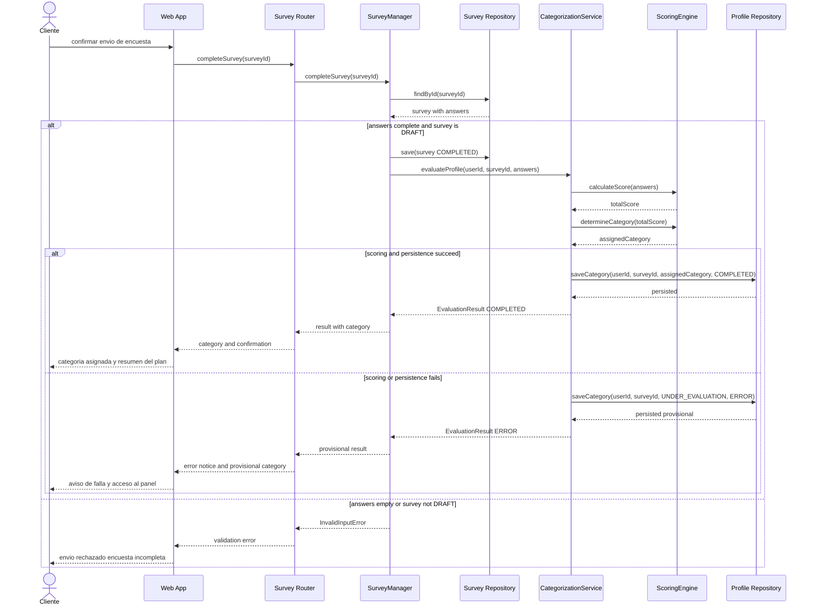
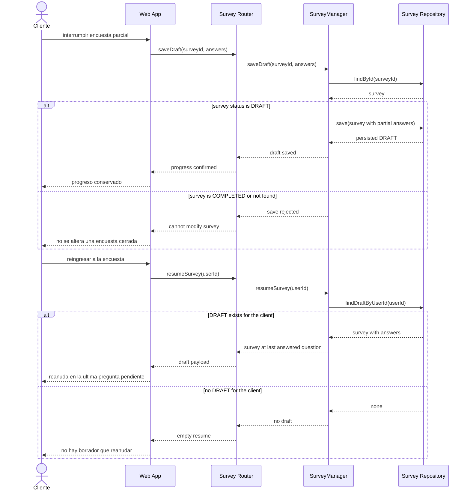
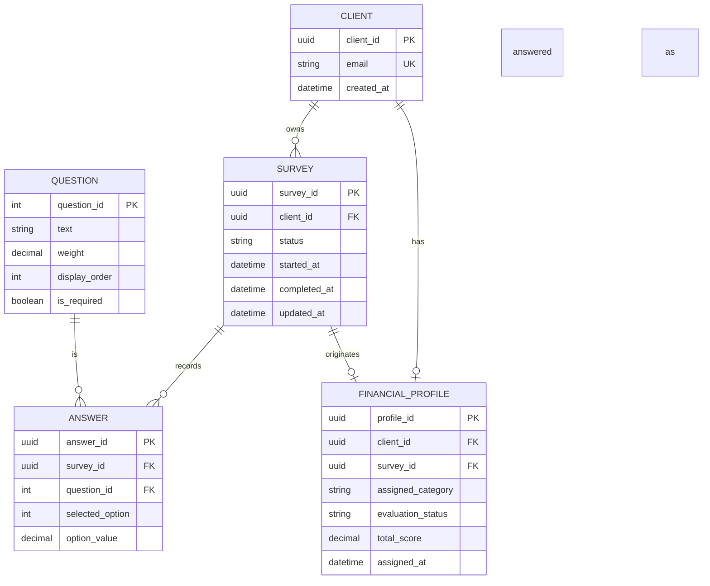

# Asesor Financiero Personal — Interaction & Data Design v1.0

| | |
|---|---|
| **Team** | Grupo 5 |
| **Members** | Esteban David Suárez Juan David Cortés Joel Felipe Suárez Kevin Facid Verjan |
| **Status** | Ready for review |
| **Date** | 2026-10-25 |
| **Inputs** | `docs/design/01_Architectural_and_Detailed_Design.md`, `docs/req/REQ-01.md` (requerimiento Capstone y único caso de uso especificado), `docs/adr/ADR-0001.md`, Interaction & Contracts Design v0.1 (Class 13) |

---

## 1. Behavior — Selected Use Cases

Se modelan **dos interacciones** derivadas del único requerimiento con caso de uso escrito (`REQ-01`). El caso de uso Capstone es **Catalogar Situación Financiera e Asignar Categoría** (flujo principal + excepción del Escenario 3). El caso complementario es el flujo alternativo ya identificado en requisitos y en la Entrega 1: **Abandono y reanudación de la encuesta** (Escenario 2 / estado `DRAFT`). No se inventa un segundo requerimiento: `docs/req/REQ-02.md` sigue siendo plantilla vacía.

### 1.1 Catalogar Situación Financiera e Asignar Categoría — from requirement REQ-01 (Capstone)

**Precondición del caso de uso:** el cliente creó una cuenta y está autenticado. **Supuesto de diseño:** el `userId` autenticado llega al backend con la petición; el módulo de autenticación no está diseñado en la Entrega 1 y no se introduce aquí como componente nuevo.

| Use Case step or flow | Message(s) in the diagram | Information exchanged | Operation defined in (Deliverable 1) |
|---|---|---|---|
| Main flow, steps 1–3: el cliente envía la encuesta completa | `confirmar envio de encuesta`, `completeSurvey(surveyId)`, `findById(surveyId)` | `surveyId`, encuesta con respuestas obligatorias | `SurveyManager.completeSurvey`, `SurveyRepository.findById` (capa HTTP: Survey Router) |
| Main flow, step 4: evaluar contra la matriz (incluye BR-03) | `evaluateProfile`, `calculateScore`, `determineCategory` | `userId`, `surveyId`, `answers`, `totalScore`, categoría | `CategorizationService.evaluateProfile`, `ScoringEngine.calculateScore`, `ScoringEngine.determineCategory` |
| Main flow, steps 5–6: persistir categoría y mostrar confirmación | primer `alt` interno, `saveCategory` con `COMPLETED` | categoría de inicio, `totalScore`, estado `COMPLETED` | `ProfileRepository.saveCategory`, `EvaluationResult` |
| Exception (Escenario 3 / REQ-01): falla de evaluación | segundo `alt` interno | categoría `UNDER_EVALUATION`, estado `ERROR`, `totalScore` nulo | `evaluateProfile` (bloque de excepción de la sección 3.4) |
| Alternative rejected at submit: envío inválido | `else answers empty or survey not DRAFT` | `InvalidInputError` | `completeSurvey` / precondición de `evaluateProfile` |

*Cada mensaje tiene un propósito (cargar, transicionar, calcular, persistir o notificar). El orden respeta las capas de la Entrega 1 (`Router → Service → Repository` y Survey → Categorization). BR-03 no es un camino de secuencia aparte: queda encapsulado en `determineCategory`. El “resumen del plan” del paso 6 del caso de uso se trata como presentación derivada de la categoría, no como un módulo nuevo (ver sección 5).*

### 1.2 Abandono y reanudación de la encuesta — from requirement REQ-01 (Escenario 2)

| Use Case step or flow | Message(s) in the diagram | Information exchanged | Operation defined in (Deliverable 1) |
|---|---|---|---|
| Alternative flow: abandono con respuestas parciales | `saveDraft`, `findById`, `save` | `surveyId`, `answers` parciales, estado `DRAFT` | `SurveyManager.saveDraft`, `SurveyRepository.findById`, `SurveyRepository.save` |
| Exception of this interaction: no se modifica una encuesta ya cerrada | `else survey is COMPLETED or not found` | rechazo de guardado | `saveDraft` (invariante de estado `SurveyStatus`) |
| Alternative flow: reingreso y reanudación | `resumeSurvey`, `findDraftByUserId` | `userId`, encuesta `DRAFT`, última pregunta respondida | `SurveyManager.resumeSurvey`, `SurveyRepository.findDraftByUserId` |
| Alternative of resume: no hay borrador | `else no DRAFT for the client` | ausencia de encuesta abierta | `resumeSurvey` |

*La “última pregunta pendiente” no se persiste como cursor de UI: se deriva del conjunto de `ANSWER` ya guardadas frente al catálogo de preguntas (sección 2.1). `findDraftByUserId` y `resumeSurvey` se añadieron a la Entrega 1 al concretar este flujo (sección 4).*

---

## 2. Data Design

### 2.1 Principal information the system needs

| Information | Needed by (use cases) | Persisted? | Why (or why not) |
|---|---|---|---|
| Identidad del cliente (`userId`) | Ambos (precondición de autenticación) | Yes | Las encuestas y la categoría de inicio (BR-01) deben quedar asociadas a la misma persona en el tiempo. No se modela aquí el ciclo de vida de autenticación. |
| Encuesta y su estado (`DRAFT` / `COMPLETED` / `ERROR`) | Capstone y reanudación | Yes | El Escenario 2 exige recuperar un borrador. El flujo principal exige transicionar a `COMPLETED`. |
| Respuestas del cliente | Capstone (cálculo) y reanudación (progreso) | Yes | Sin persistirlas, el abandono perdería información (riesgo mitigado en REQ-01). Son la única entrada del motor de evaluación (restricción: sin APIs bancarias). |
| Catálogo de preguntas (texto, peso, orden, obligatoriedad) | Capstone y reanudación | Yes | El caso de uso habla de preguntas parametrizadas y BR-02 limita a 10. Deben existir con identidad estable para referenciar respuestas. |
| Perfil financiero (categoría, estado de evaluación, puntaje, encuesta origen) | Capstone | Yes | BR-01: todo cliente debe tener categoría de inicio antes de ver recomendaciones. El Escenario 3 exige persistir `UNDER_EVALUATION`. |
| Matriz de umbrales / algoritmo de desempate BR-03 | Capstone | No | Es conocimiento encapsulado en `ScoringEngine` (ocultamiento de información de la Entrega 1). Persistirlo como tabla de usuario crearía una segunda fuente de verdad. |
| ETA / datos bancarios / extractos | Ninguno en REQ-01 | No | Restricción explícita del requerimiento: la categorización se resuelve internamente. |
| Resumen visual del plan mostrado al finalizar | Capstone, paso 6 | No | La Entrega 1 no tiene módulo de Plan. El resumen se deriva de la categoría asignada en presentación. Inventar un documento de plan persistido sería especificación, no diseño del comportamiento ya escrito. |
| Cursor de UI (índice de la última pantalla vista) | Reanudación | No | Se recompute como la primera pregunta obligatoria sin `ANSWER`. Un cursor persistido se desincronizaría si cambia el orden del catálogo. |

### 2.2 Data model

**Justificación de representación (formato pedido):** Because [ADR-0001 exige PostgreSQL con integridad referencial y `NUMERIC` para puntajes] / We chose [modelo relacional Entidad-Relación, no documentos] / Accepting [un esquema más rígido y migraciones ante cambios de catálogo, a cambio de no duplicar fuentes de verdad entre encuesta y perfil].

Otras decisiones del modelo, con el mismo formato:

| Decision | Because / We chose / Accepting |
|---|---|
| Perfil financiero separado de la encuesta | Because [BR-01 coloca la categoría en el cliente, y el riesgo de REQ-01 contempla reevaluar más adelante] / We chose [un `FINANCIAL_PROFILE` 0..1 por cliente, con N encuestas históricas] / Accepting [`survey_id` en el perfil es una referencia al origen de la categoría vigente, no un historial completo de evaluaciones] |
| Preguntas como catálogo compartido, no snapshot por encuesta | Because [el cuestionario es parametrizado y acotado por BR-02] / We chose [tabla `QUESTION` referenciada por `ANSWER`] / Accepting [editar el texto o el peso de una pregunta puede reinterpretar encuestas antiguas si no hay versionado — ver sección 5] |
| A lo sumo un `DRAFT` por cliente | Because [el Escenario 2 habla de *la* encuesta interrumpida, no de varias en paralelo] / We chose [invariante de unicidad parcial sobre `(client_id)` donde `status = DRAFT`] / Accepting [el cliente no puede iniciar un segundo cuestionario hasta completar o descartar el borrador — el descarte no está especificado] |
| Puntaje nulo cuando el estado de evaluación es `ERROR` | Because [la sección 3.4 de la Entrega 1 devuelve `totalScore = null` en el Escenario 3] / We chose [`total_score` opcional] / Accepting [no se puede auditar un puntaje fallido si el motor ni siquiera terminó el cálculo] |

| Entity / document type | Meaning in the system | Identifier | Constraints (required, unique, allowed values) |
|---|---|---|---|
| `CLIENT` | Persona autenticada dueña de encuestas y del perfil de inicio | `client_id` | `email` obligatorio y único. No hay clase `Client` en los diagramas de la Entrega 1: se persiste como identidad referenciada por `userId`. |
| `SURVEY` | Una ejecución del cuestionario de onboarding | `survey_id` | `status` ∈ {`DRAFT`, `COMPLETED`}. `completed_at` solo si `status = COMPLETED`. A lo sumo un `DRAFT` por `client_id`. El Escenario 3 no reabre ni marca la encuesta como `ERROR`: ese estado vive en `FINANCIAL_PROFILE.evaluation_status`, para que `saveDraft` siga rechazando un envío ya cerrado. |
| `QUESTION` | Pregunta parametrizada del cuestionario breve | `question_id` | `text` y `weight` obligatorios. `weight` ≥ 0 con tipo `NUMERIC`. `display_order` único. A lo sumo 10 preguntas activas (BR-02). |
| `ANSWER` | Opción elegida por el cliente en una pregunta de una encuesta | `answer_id` | Par (`survey_id`, `question_id`) único. `selected_option` entero positivo. `option_value` `NUMERIC` no nulo cuando existe respuesta. |
| `FINANCIAL_PROFILE` | Categoría de inicio vigente del cliente (BR-01) | `profile_id` | `client_id` único. `assigned_category` ∈ {`CONSERVATIVE`, `MODERATE`, `AGGRESSIVE`, `UNDER_EVALUATION`}. `evaluation_status` ∈ {`COMPLETED`, `ERROR`}. Si `ERROR`, categoría = `UNDER_EVALUATION` y `total_score` nulo. `survey_id` obligatorio (qué encuesta produjo el perfil). |

### 2.3 Data Ownership

Ningún componente lee ni escribe tablas de otro. PostgreSQL es el almacén, no el dueño de negocio. El dueño autoritativo es el componente que mantiene el invariante.

| Information | Authoritative owner (component responsible for maintaining it) | Consumed by (uses it without owning it) | Access through |
|---|---|---|---|
| Encuesta, estado y respuestas | Survey Module (`SurveyManager` + `Survey Repository`) | Categorization Module (solo el conjunto de `answers` al evaluar) | `startSurvey`, `saveDraft`, `resumeSurvey`, `completeSurvey`, `SurveyRepository` |
| Catálogo de preguntas y pesos | Survey Module (`Survey Repository`) | `ScoringEngine` (consume valores ya resueltos en `Answer.getValue()`, no consulta SQL) | carga de encuesta / `Question` |
| Perfil financiero (categoría, estado de evaluación, puntaje) | Categorization Module (`CategorizationService` + `Profile Repository`) | Web App (solo para mostrar confirmación y panel) | `evaluateProfile`, `ProfileRepository.saveCategory` / `findByUserId` |
| Identidad `CLIENT` / `userId` | Fuera del alcance detallado de los módulos seleccionados en Entrega 1 (cuenta previa a la encuesta) | Survey Module y Categorization Module (FK, nunca actualizan email ni credenciales) | parámetro `userId` en las operaciones |
| Matriz y umbrales BR-03 | `ScoringEngine` (conocimiento interno, no fila persistida) | `CategorizationService` | `calculateScore`, `determineCategory` |
| Datos de tracking / banca externa | N/A — no existen en este sistema | Nadie | N/A |

### 2.4 Business rules and invariants enforced in data

| Business rule or invariant | Where it is enforced (component logic / data constraint / both) | How |
|---|---|---|
| **BR-01** — categoría de inicio antes de recomendaciones | Both | Lógica: el panel de plan no se personaliza sin `FINANCIAL_PROFILE`. Datos: `assigned_category` obligatorio en el perfil. El Escenario 3 cumple BR-01 con `UNDER_EVALUATION` en lugar de dejar el perfil vacío. |
| **BR-02** — máximo 10 preguntas | Both | Datos: a lo sumo 10 filas activas en `QUESTION`. Lógica: `startSurvey` arma el cuestionario desde ese catálogo. |
| **BR-03** — desempate al menor riesgo en el umbral | Component logic | Solo `ScoringEngine.determineCategory`. No hay columna “empate”: el resultado ya es la categoría conservadora. |
| Una encuesta `COMPLETED` no vuelve a `DRAFT` ni acepta `saveDraft` | Both | Lógica: `saveDraft` rechaza si `status ≠ DRAFT`. Datos: `completed_at` inmutable una vez fijado. |
| A lo sumo un `DRAFT` por cliente | Data | Índice único parcial `(client_id) WHERE status = DRAFT`. |
| Una respuesta por pregunta y encuesta | Data | Unique (`survey_id`, `question_id`). |
| Categoría provisional coherente con el Escenario 3 | Both | Lógica: `evaluateProfile` en falla llama `saveCategory(..., UNDER_EVALUATION, ERROR)`. Datos: check de coherencia categoría/estado. |
| Precisión decimal del puntaje | Data | `total_score`, `weight` y `option_value` como `NUMERIC` (ADR-0001), no punto flotante. |

---

## 3. Interface Contract

**Interaction chosen** (from diagram 1.1, message `evaluateProfile` de `SurveyManager` hacia `CategorizationService`):
> Es el punto en el que el ciclo de vida de la encuesta entrega el control al cálculo de categoría. Ahí se concentran BR-01, BR-03, la precisión decimal y el Escenario 3 (no bloquear al cliente con un 500).

| Element | Specification |
|---|---|
| **Operation and purpose** | `evaluateProfile(userId, surveyId, answers)`: calcular la categoría de inicio del cliente a partir de las respuestas de una encuesta ya enviada y dejar el perfil persistido. Si el cálculo o la persistencia fallan, igual deja una categoría provisional para no impedir el acceso al panel. |
| **Input** (parameters and types) | `userId`: UUID no nulo del cliente autenticado. `surveyId`: UUID no nulo de la encuesta enviada. `answers`: lista no vacía de `Answer` (`questionId: int`, `selectedOption: int`, `optionValue: Decimal`). |
| **Output** (successful result and data structure) | `EvaluationResult { surveyId: UUID, assignedCategory: FinancialCategory, totalScore: Decimal \| null, status: string }`. En éxito de cálculo: `status = COMPLETED`, `assignedCategory` ∈ {`CONSERVATIVE`, `MODERATE`, `AGGRESSIVE`}, `totalScore` no nulo. |
| **Preconditions** (what the caller must satisfy before invoking) | El llamador (`SurveyManager`) ya persistió la encuesta como `COMPLETED` y garantiza que las respuestas cubren las preguntas obligatorias. `userId` corresponde al dueño de `surveyId`. `answers` no está vacía. El catálogo usado para responder sigue siendo el vigente (no hay versionado — supuesto). |
| **Postconditions** (what is guaranteed on successful completion) | Existe exactamente un `FINANCIAL_PROFILE` para `userId`. `assigned_category` y `evaluation_status` coinciden con el `EvaluationResult` devuelto. `survey_id` del perfil es el de esta invocación. BR-03 ya está aplicada: un puntaje en umbral no produce dos categorías. |
| **Failure outcomes** (each failure, and what state is left after it) | `invalidInput` (`answers` vacía): no se llama a `saveCategory`; el perfil no cambia; el llamador no debería haber marcado `COMPLETED` en este caso (el diagrama 1.1 rechaza antes). Fallo de cálculo o de persistencia durante el `try`: se intenta `saveCategory(userId, surveyId, UNDER_EVALUATION, ERROR)`; se devuelve `EvaluationResult` con `status = ERROR`, categoría `UNDER_EVALUATION` y `totalScore = null`. Si también falla esa persistencia provisional, el perfil puede quedar sin actualizar: queda registrado como pregunta abierta (sección 5), no se inventa una cola de reintentos (ADR-0001 rechazó brokers). En ningún caso se altera el contenido de `ANSWER`. |
| **Invariants and side effects** (what must stay true, what may change) | No se reescriben respuestas. No se crea un segundo perfil para el mismo `userId` (upsert). `ScoringEngine` no persiste. La operación no es idempotente en el puntaje si el catálogo de pesos cambia entre llamadas, pero sí deja un único perfil vigente. Efecto de lado: escritura en `FINANCIAL_PROFILE`. |

**Testable examples**

| Case | Before | Request | Expected |
|---|---|---|---|
| Cálculo exitoso (Escenario 1) | Encuesta `COMPLETED` con 10 respuestas. Sin perfil, o perfil previo irrelevante. | `evaluateProfile(U1, S1, answers[10])` con puntaje interior a una banda | `EvaluationResult(S1, categoría de esa banda, totalScore, COMPLETED)`. Una fila de perfil para `U1`. |
| Empate en umbral (BR-03) | Igual, puntaje exactamente en el límite entre Moderado y Conservador | `evaluateProfile(U1, S1, answers)` | `assignedCategory = CONSERVATIVE` (menor riesgo), `status = COMPLETED`. |
| Falla del motor (Escenario 3) | Encuesta `COMPLETED`. `ScoringEngine` o `saveCategory` de éxito lanzan error | `evaluateProfile(U1, S1, answers)` | `EvaluationResult(S1, UNDER_EVALUATION, null, ERROR)`. Perfil persistido provisional. El cliente puede ir al panel. |
| Entrada inválida | Cualquiera | `evaluateProfile(U1, S1, [])` | `InvalidInputError`. Perfil intacto. |
| Reevaluación posterior | Perfil `COMPLETED` de encuesta `S0` | `evaluateProfile(U1, S2, answers')` | Un solo perfil de `U1`, ahora con `survey_id = S2` y nueva categoría. `S0` permanece en historial de encuestas. |

Los umbrales numéricos exactos de cada banda **no** están en REQ-01. Los ejemplos anteriores son comprobables en forma, no en el valor del `Decimal` (sección 5).

---

## 4. Cross-Consistency & Changes to Deliverable 1

| Check | Result |
|---|---|
| Every participant in a sequence diagram is an actor, a component, a class or an external system from Deliverable 1 | Cumple. `Cliente` es el actor (2.1). `Web App`, `Survey Router`, `Survey Repository`, `Profile Repository` son componentes (2.2). `SurveyManager`, `CategorizationService` y `ScoringEngine` son clases (3.2). No hay sistemas externos: REQ-01 lo prohíbe. |
| Every message corresponds to a capability, operation or contract | Cumple. `completeSurvey`, `saveDraft`, `resumeSurvey`, `evaluateProfile`, `calculateScore`, `determineCategory`, `findById`, `findDraftByUserId`, `save`, `saveCategory` están en la Entrega 1 actualizada. Las acciones del cliente son disparadores de UI, no operaciones internas. |
| Every entity or document type is reflected in the class diagrams, or the reason it is not is stated | `SURVEY`, `QUESTION`, `ANSWER` ↔ clases `Survey`, `Question`, `Answer`. `FINANCIAL_PROFILE` ↔ `EvaluationResult` + `FinancialCategory` + `ProfileRepository` (no había clase `FinancialProfile`; el repositorio ahora expone `findByUserId`). `CLIENT` no tiene clase: la Entrega 1 no diseñó autenticación; solo viaja como `userId`. |
| Every persisted information element has exactly one authoritative owner | Cumple (tabla 2.3). `CLIENT` se declara fuera de los módulos seleccionados, no se duplica la propiedad. |
| The contract agrees with the sequence diagram and with the data model (same behavior in all three views) | Cumple. Los dos `alt` internos del diagrama 1.1 son los resultados `COMPLETED` y `ERROR` del contrato. El perfil persistido es `FINANCIAL_PROFILE`. `answers` vacías se rechazan antes o con `invalidInput`, sin categoría inventada. |

**Changes made to Deliverable 1 because of this deliverable**
> Al volver concreto el intercambio de mensajes y el dueño del dato “categoría de inicio”, la Entrega 1 tenía tres huecos reales, no estéticos. Se actualizó `docs/design/01_Architectural_and_Detailed_Design.md`:
>
> 1. `ProfileRepository.saveCategory` y `evaluateProfile` usaban `surveyId` o `userId` de forma inconsistente entre el diagrama de clases y el pseudocódigo 3.4. **Now:** ambas operaciones reciben `userId` y `surveyId`, porque BR-01 vive en el perfil del cliente y la encuesta es el origen.
> 2. El Escenario 2 exigía reanudar “la” encuesta en borrador, pero no existía `findDraftByUserId` ni `resumeSurvey`. **Now:** ambas operaciones están en `SurveyRepository` / `SurveyManager`.
> 3. `SurveyManager.completeSurvey` devolvía `Survey` y no declaraba colaboración con categorización, aunque la tabla de componentes ya decía “enviar respuestas finales al evaluador”. **Now:** `completeSurvey` invoca `evaluateProfile` y devuelve `EvaluationResult`.
> 4. Se añadió la clase `FinancialProfile` (y `ProfileRepository.findByUserId`) porque el modelo de datos necesita un dueño persistente de la categoría vigente, distinto del DTO `EvaluationResult`.
> 5. `SurveyStatus.ERROR` deja de usarse para el Escenario 3: la encuesta enviada permanece `COMPLETED` y el fallo se registra en `FINANCIAL_PROFILE.evaluation_status`, de modo que no se pueda volver a `saveDraft`.
>
> No se añadió un módulo de Plan ni un broker de reintentos: eso habría inventado comportamiento que REQ-01 deja abierto y que ADR-0001 rechazó.

---

## 5. Open Questions

> **Umbrales numéricos de categoría.** REQ-01 y BR-03 definen el desempate en el límite, pero no los valores de cada banda. No se inventan cortes. Hasta que producto/finanzas entregue la matriz, `determineCategory` no es implementable con números reales; el contrato sí es implementable en forma.
>
> **Dominio de `selected_option`.** El caso de uso no lista opciones por pregunta. Se asume entero positivo y un `option_value` Decimal ya resuelto. El catálogo concreto de opciones es trabajo de especificación, no de este diseño.
>
> **Fallo doble de persistencia provisional.** El Escenario 3 asume que se puede guardar `UNDER_EVALUATION`. Si también falla `saveCategory` provisional, REQ-01 no dice qué mostrar. No se introduce una cola (ADR-0001). Queda pendiente con el stakeholder si el cliente entra al panel sin fila de perfil o ve un error bloqueante.
>
> **“Reintento en segundo plano”** del flujo de excepción en REQ-01. La Entrega 1 rechazó mensajería asíncrona. Este diseño deja el perfil en `ERROR` y no programa un worker. El mecanismo de reintento (manual, cron o botón) no está especificado.
>
> **Versionado del catálogo de preguntas.** Al persistir pesos en `QUESTION` sin versión, un cambio de enunciado o peso puede reinterpretar encuestas históricas. No hay requisito de auditoría histórica.
>
> **Descarte de un `DRAFT`.** El Escenario 2 cubre guardar y reanudar, no abandonar de forma explícita. No se define `cancelDraft`.
>
> **Módulo de autenticación y de Plan.** La precondición “cuenta creada” y el paso 6 “resumen del plan” se satisfacen por `userId` ya autenticado y por presentación derivada de la categoría. No se diseñan aquí.

---

## 6. Optional — AI-Assisted Design Reflection

> Una recomendación generada por IA fue **persistir la matriz de ponderación y los umbrales BR-03 como tablas editables**, y **guardar el último `EvaluationResult` embebido dentro de `SURVEY`** para “simplificar lecturas”.
>
> **El equipo la modificó, no la copió.** Se persistieron `weight` y `option_value` (parámetros de pregunta/respuesta que el cuestionario ya necesita), pero los umbrales y el desempate siguen ocultos en `ScoringEngine`, coherente con la Entrega 1. Se rechazó embeber el perfil en la encuesta: BR-01 habla de la categoría del *cliente*, y el riesgo de reevaluación implica varias encuestas frente a un solo perfil vigente.
>
> **Por qué:** duplicar la categoría en `SURVEY.status` y en un JSON de resultado crearía dos dueños para el mismo hecho, contradiciendo la tabla 2.3. Aceptamos el costo de un `JOIN` perfil–encuesta y de un upsert en `FINANCIAL_PROFILE`.
>
> Otra sugerencia de IA (cola de mensajes para el Escenario 3) se **rechazó de nuevo**, igual que en la Entrega 1 / ADR-0001: el contrato devuelve siempre un `EvaluationResult` síncrono, con categoría provisional si el cálculo falla.

---

## 7. Consistency Checklist

- [x] Two use cases from the project, each traceable to a Use Case written in the requirements.
- [x] Each sequence diagram shows the main flow and at least one alternative or exception flow.
- [x] No business behavior is invented: anything unspecified is marked as an assumption or Open Question.
- [x] Section 2.1 explains what is NOT persisted as well as what is.
- [x] The data model has identifiers, relationships and constraints, not only boxes.
- [x] Every piece of principal information has one authoritative owner, and consumers are listed (Section 2.3).
- [x] The contract defines input, output, preconditions, postconditions and failure outcomes.
- [x] Sequence, data model and contract describe the same behavior.
- [x] Diagrams render correctly on GitHub (or the exported images are embedded).
