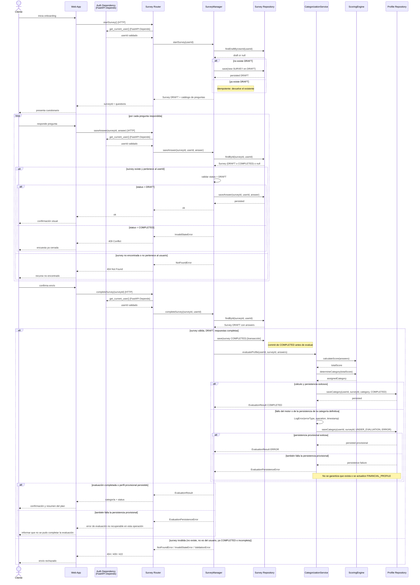
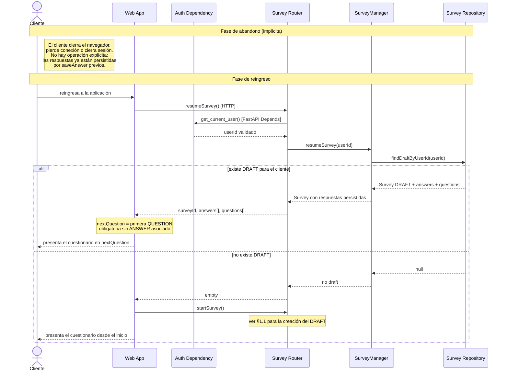
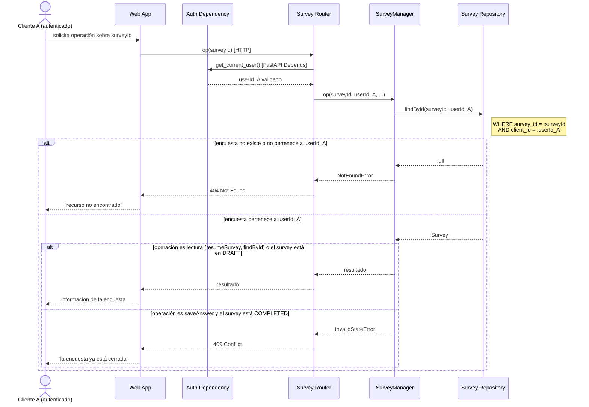
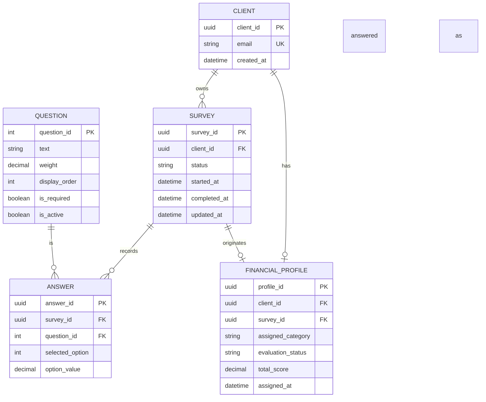

# Cambios previos requeridos en `01_Architectural_and_Detailed_Design.md`

Antes del `02`, dos ajustes al `01` para que todo sea consistente:

| Sección | Cambio |
|---|---|
| §3.2 enum `SurveyStatus` | Eliminar `ERROR`. Solo `{DRAFT, COMPLETED}`. El error vive en `FINANCIAL_PROFILE.evaluation_status`. |
| §3.2 `SurveyRepository` | Reemplazar `saveDraft` por `saveAnswer(surveyId, userId, answer)`. Mantener `findById(surveyId, userId)`, `findDraftByUserId(userId)`, `save(survey)`. |
| §3.2 `SurveyManager` | Reemplazar `saveDraft` por `saveAnswer(surveyId, userId, answer)`. Mantener `startSurvey(userId)`, `resumeSurvey(userId)`, `completeSurvey(surveyId, userId)`. |
| §3.3 | Actualizar la responsabilidad de `SurveyRepository` para incluir `saveAnswer` con validación de estado y ownership. |

Con esto, el `02` queda alineado con `01` y con `REQ-01_definitivo.md`. Abajo el `02` completo.

---

# Asesor Financiero Personal — Interaction & Data Design v1.2

| | |
|---|---|
| **Team** | Grupo 5 |
| **Members** | Esteban David Suárez Juan David Cortés Joel Felipe Suárez Kevin Facid Verjan |
| **Status** | Definitive design baseline — open decisions documented in §5 |
| **Date** | 2026-10-25 |
| **Inputs** | `docs/design/01_Architectural_and_Detailed_Design.md` (v1.1), `docs/req/REQ-01.md` (definitivo), `docs/adr/ADR-0001.md`, Interaction & Contracts Design v0.1 (Class 13) |

---

## 1. Behavior — Selected Use Cases

Se modelan **tres interacciones** derivadas del único caso de uso escrito en `REQ-01`; no son tres casos de uso independientes. La primera es el **happy-path** completo (captura + evaluación). La segunda es el **flujo alternativo de abandono y reanudación** (Escenario 2). La tercera es la **respuesta al riesgo de REQ-01**: violación de ownership. No se inventa un segundo requerimiento: `docs/req/REQ-02.md` sigue siendo plantilla vacía.

**Nota transversal — origen del `userId`.** En todos los diagramas, el `userId` se obtiene del contexto de autenticación validado por el backend (dependencia de FastAPI `Depends(get_current_user)`), **nunca** del cuerpo de la petición HTTP. El participante `Auth Dependency` representa esa dependencia, no un módulo de autenticación diseñado en la Entrega 1. La dependencia se ejecuta en el servidor al procesar cada petición; la Web App no la invoca directamente. En persistencia, `userId` corresponde a `CLIENT.client_id`.

### 1.1 Happy-Path: Catalogar Situación Financiera e Asignar Categoría — REQ-01 (Escenario 1)

**Precondición:** el cliente creó una cuenta y está autenticado. **Supuesto de diseño:** la dependencia de autenticación entrega el `userId` al `Survey Router` antes de que este delegue en `SurveyManager`. El módulo de autenticación no está diseñado en la Entrega 1 y no se introduce como componente nuevo.

| Use Case step or flow | Message(s) in the diagram | Information exchanged | Operation defined in (Deliverable 1) |
|---|---|---|---|
| Precondición: cliente autenticado | `get_current_user()`, `userId` | token/sesión → `userId` | Dependencia de FastAPI, no diseñada en Entrega 1 |
| Main flow, paso 1–2: inicio de la encuesta | `startSurvey`, `findDraftByUserId`, `save` | `userId`, `Survey DRAFT` (nuevo o existente) | `SurveyManager.startSurvey`, `SurveyRepository.findDraftByUserId`, `SurveyRepository.save` |
| Main flow, paso 2: carga del catálogo | `questions` en el output de `startSurvey` | catálogo de `QUESTION` | `SurveyManager.startSurvey` (output `Survey` incluye `questions`) |
| Main flow, paso 3 (progresivo): captura de cada respuesta | `saveAnswer`, `findById`, `saveAnswer` | `surveyId`, `userId`, `answer` individual; validación de estado `DRAFT` y propiedad | `SurveyManager.saveAnswer`, `SurveyRepository.findById`, `SurveyRepository.saveAnswer` |
| Main flow, paso 4: envío y evaluación (incluye BR-03) | `completeSurvey`, `evaluateProfile`, `calculateScore`, `determineCategory` | `userId`, `surveyId`, `answers`, `totalScore`, categoría | `SurveyManager.completeSurvey`, `CategorizationService.evaluateProfile`, `ScoringEngine.calculateScore`, `ScoringEngine.determineCategory` |
| Main flow, paso 5: persistencia exitosa | `saveCategory` con `COMPLETED` | categoría, `totalScore`, estado `COMPLETED` | `ProfileRepository.saveCategory` |
| Exception flow (Escenario 3 REQ-01): fallo del motor | `LogError`, `saveCategory` con `UNDER_EVALUATION`/`ERROR` | `errorType`, `operation`, `timestamp` (sin datos sensibles); perfil provisional si su persistencia tiene éxito | `CategorizationService.evaluateProfile` (bloque de excepción de §3.4 del `01`) |
| Alternative rechazada: envío inválido o estado no `DRAFT` | `else survey inválida` | `NotFoundError`, `InvalidStateError`, `ValidationError` | `completeSurvey` / precondiciones de `evaluateProfile` |

*Cada mensaje tiene un propósito (autenticar, cargar, transicionar, calcular, persistir o notificar). El orden respeta las capas del `01` (`Router → Service → Repository` y Survey → Categorization). BR-03 queda encapsulado en `determineCategory`. El "resumen del plan" del paso 6 se trata como presentación derivada de la categoría (ver §5). La persistencia de respuestas es **progresiva**: cada `saveAnswer` es una transacción independiente, lo que responde al requisito de recuperación tras desconexión (ver §1.2).*

### 1.2 Abandono, Recuperación y Reanudación — REQ-01 (Escenario 2)

**Supuesto de diseño:** el abandono no se modela como una operación explícita del cliente (`saveDraft` en `beforeunload` no es confiable). Cada respuesta ya está persistida por `saveAnswer` cuando el cliente interrumpe el flujo. La "recuperación" es una lectura: `resumeSurvey(userId)` trae el `DRAFT` existente con todas las respuestas persistidas hasta el último `saveAnswer` exitoso.

| Use Case step or flow | Message(s) in the diagram | Information exchanged | Operation defined in (Deliverable 1) |
|---|---|---|---|
| Alternative flow: abandono con respuestas parciales | (implícito, no hay mensaje) | estado persistido en `ANSWER` por `saveAnswer` previos | `SurveyRepository.saveAnswer` (invocado durante la captura) |
| Alternative flow: reingreso y reanudación | `resumeSurvey`, `findDraftByUserId` | `userId`, encuesta `DRAFT` con sus `ANSWER` | `SurveyManager.resumeSurvey`, `SurveyRepository.findDraftByUserId` |
| Alternative of resume: no hay borrador | `else no existe DRAFT` | ausencia de encuesta abierta; se dispara `startSurvey` | `resumeSurvey`, `startSurvey` |
| Derivación del cursor de UI | `nextQuestion` calculado en el cliente | comparación entre `QUESTION` obligatorias y `ANSWER` existentes | No persistido; derivado en presentación (ver §2.1) |

*La "última pregunta pendiente" **no** se persiste como cursor de UI: se recomputa como la primera `QUESTION` obligatoria sin `ANSWER` asociada, comparando el catálogo vigente con las respuestas recuperadas. Persistir el cursor se desincronizaría si cambia el orden del catálogo (ver §2.1). El abandono no requiere una operación `saveDraft` batch: la persistencia progresiva de §1.1 ya deja las respuestas en PostgreSQL, que es la **única fuente autoritativa**.*

### 1.3 Violación de Ownership — Respuesta al riesgo de REQ-01

Este flujo materializa el riesgo de filtración de datos formulado en `REQ-01_definitivo.md`. Es la evidencia visual de la mitigación: **el backend no distingue entre "no existe" y "existe pero no es tuyo"**, por lo que responde 404 en ambos casos (no 403, no 500), evitando filtrar la existencia del recurso.

| Use Case step or flow | Message(s) in the diagram | Information exchanged | Operation defined in (Deliverable 1) |
|---|---|---|---|
| Riesgo de REQ-01: acceso o modificación no autorizados | `get_current_user`, `findById(surveyId, userId_A)` | `userId_A` (autenticado); `surveyId` (posiblemente ajeno) | `SurveyRepository.findById` (filtro por `userId` en la query) |
| Caso violación: `surveyId` es de otro usuario | rama `null` del `alt` | rechazo sin revelar existencia | `SurveyRepository.findById` + traducción a 404 en `SurveyManager` / `SurveyRouter` |
| Caso violación: intento de modificar `COMPLETED` | rama `InvalidStateError` | rechazo de mutación; `COMPLETED` es inmutable | Invariante de estado en `SurveyRepository.saveAnswer` |
| Caso legítimo: lectura o DRAFT propio | rama `Survey` del `alt` | resultado normal | `findById`, `resumeSurvey` |

*Decisión de diseño explícita: **404, no 403**. Un 403 le confirmaría al atacante que la encuesta existe pero pertenece a otro usuario, filtrando información. Un 404 es indistinguible de "no existe". Esta misma lógica aplica a `ProfileRepository.findByUserId`: solo devuelve el perfil del `userId` autenticado. La comprobación es doble: en la query del repositorio (`WHERE client_id = :userId`) y en la validación del estado (`status = DRAFT` para `saveAnswer`).*

---

## 2. Data Design

### 2.1 Principal information the system needs

| Information | Needed by (use cases) | Persisted? | Why (or why not) |
|---|---|---|---|
| Identidad del cliente (`userId`) | Todos los flujos | **No** en el modelo de encuestas; vive en el token/sesión | El `userId` se obtiene del contexto de autenticación y corresponde al valor de `CLIENT.client_id`. `SURVEY.client_id` y `FINANCIAL_PROFILE.client_id` lo referencian como FK. No se persisten credenciales ni datos de sesión en el modelo de encuestas. |
| Encuesta y su estado (`DRAFT` / `COMPLETED`) | Happy-path, reanudación, violación de ownership | Yes | El Escenario 2 exige recuperar un borrador. El flujo principal exige transicionar a `COMPLETED`. **`SURVEY.status` no incluye `ERROR`:** ese estado pertenece a `FINANCIAL_PROFILE.evaluation_status`. |
| Respuestas del cliente | Happy-path (cálculo), reanudación (progreso) | Yes | Sin persistirlas, el abandono perdería información. Son la única entrada del motor de evaluación. Se persisten **progresivamente** por `saveAnswer`, no en lote. |
| Catálogo de preguntas (texto, peso, orden, obligatoriedad) | Happy-path, reanudación | Yes | El caso de uso habla de preguntas parametrizadas y BR-02 limita a 10. Deben existir con identidad estable para referenciar respuestas. |
| Perfil financiero (categoría, estado de evaluación, puntaje, encuesta origen) | Happy-path | Yes | BR-01: todo cliente debe tener categoría de inicio antes de ver recomendaciones. El Escenario 3 exige persistir `UNDER_EVALUATION`. |
| Matriz de umbrales / algoritmo de desempate BR-03 | Happy-path | **No** | Conocimiento encapsulado en `ScoringEngine` (ocultamiento de información). Persistirlo como tabla crearía una segunda fuente de verdad. |
| ETA / datos bancarios / extractos | Ninguno en REQ-01 | **No** | Restricción explícita: la categorización se resuelve internamente sin APIs bancarias. |
| Resumen visual del plan | Happy-path, paso 6 | **No** | No existe módulo de Plan. Se deriva de la categoría asignada en presentación. |
| Cursor de UI (índice de última pantalla) | Reanudación | **No** | Se recomputa como la primera `QUESTION` obligatoria sin `ANSWER`. Un cursor persistido se desincronizaría si cambia el orden del catálogo. |

### 2.2 Data model

**Justificación de representación (formato pedido):** Because [ADR-0001 exige PostgreSQL con integridad referencial y `NUMERIC` para puntajes] / We chose [modelo relacional Entidad-Relación, no documentos] / Accepting [un esquema más rígido y migraciones ante cambios de catálogo, a cambio de no duplicar fuentes de verdad entre encuesta y perfil].

Otras decisiones del modelo, con el mismo formato:

| Decision | Because / We chose / Accepting |
|---|---|
| Perfil financiero separado de la encuesta | Because [BR-01 coloca la categoría en el cliente, y el riesgo de REQ-01 contempla reevaluar más adelante] / We chose [un `FINANCIAL_PROFILE` 0..1 por cliente, con N encuestas históricas] / Accepting [`survey_id` en el perfil es una referencia al origen de la categoría vigente, no un historial completo de evaluaciones] |
| Preguntas como catálogo compartido, no snapshot por encuesta | Because [el cuestionario es parametrizado y acotado por BR-02] / We chose [tabla `QUESTION` referenciada por `ANSWER`] / Accepting [editar el texto o el peso de una pregunta puede reinterpretar encuestas antiguas si no hay versionado — ver §5] |
| A lo sumo un `DRAFT` por cliente | Because [el Escenario 2 habla de *la* encuesta interrumpida, no de varias en paralelo] / We chose [invariante de unicidad parcial sobre `(client_id)` donde `status = DRAFT`] / Accepting [el cliente no puede iniciar un segundo cuestionario hasta completar o descartar el borrador — el descarte no está especificado] |
| Puntaje nulo cuando el estado de evaluación es `ERROR` | Because [la sección 3.4 del `01` devuelve `totalScore = null` en el Escenario 3] / We chose [`total_score` opcional] / Accepting [no se puede auditar un puntaje fallido si el motor ni siquiera terminó el cálculo] |
| `userId` autenticado corresponde a `CLIENT.client_id` | Because [el contexto de autenticación vive en el token, no en el modelo de encuestas] / We chose [pasar `userId` como parámetro en las operaciones de repositorio; el filtro `WHERE client_id = :userId` es la última línea de defensa] / Accepting [el repositorio recibe el identificador autenticado y filtra por `client_id`; no valida el token, responsabilidad de la capa API] |
| `SURVEY.status` sin `ERROR` | Because [el `01` §3.2 y el Escenario 3 de REQ-01 separan el ciclo de la encuesta del ciclo de la evaluación] / We chose [solo `DRAFT` y `COMPLETED` en `SURVEY.status`; `ERROR` vive en `FINANCIAL_PROFILE.evaluation_status`] / Accepting [un fallo del motor no reabre la encuesta; el cliente ve la categoría provisional y puede reintentar la evaluación más adelante (fuera de alcance — §5)] |

| Entity / document type | Meaning in the system | Identifier | Constraints (required, unique, allowed values) |
|---|---|---|---|
| `CLIENT` | Persona autenticada dueña de encuestas y del perfil de inicio | `client_id` | `email` obligatorio y único. No hay clase `Client` en los diagramas del `01`: se persiste como identidad referenciada por `userId`. |
| `SURVEY` | Una ejecución del cuestionario de onboarding | `survey_id` | `status` ∈ {`DRAFT`, `COMPLETED`}. **`ERROR` no es un estado de encuesta.** `completed_at` solo si `status = COMPLETED`. A lo sumo un `DRAFT` por `client_id`. Una vez en `COMPLETED`, no vuelve a `DRAFT` ni acepta `saveAnswer`. |
| `QUESTION` | Pregunta parametrizada del cuestionario breve | `question_id` | `text` y `weight` obligatorios. `weight` ≥ 0 con tipo `NUMERIC`. `display_order` único dentro del catálogo activo. `is_active` indica si integra el cuestionario vigente. A lo sumo 10 preguntas activas (BR-02). |
| `ANSWER` | Opción elegida por el cliente en una pregunta de una encuesta | `answer_id` | Par (`survey_id`, `question_id`) único. `selected_option` entero positivo y válido para la pregunta según el catálogo de opciones acordado; `option_value` `NUMERIC` no nulo, resuelto por el backend a partir de esa opción. Se inserta o actualiza vía `saveAnswer` por transacción independiente. |
| `FINANCIAL_PROFILE` | Categoría de inicio vigente del cliente (BR-01) | `profile_id` | `client_id` único. `assigned_category` ∈ {`CONSERVATIVE`, `MODERATE`, `AGGRESSIVE`, `UNDER_EVALUATION`}. `evaluation_status` ∈ {`COMPLETED`, `ERROR`}. Si `ERROR`, categoría = `UNDER_EVALUATION` y `total_score` nulo. `survey_id` obligatorio (qué encuesta produjo el perfil). |

### 2.3 Data Ownership

Ningún componente lee ni escribe tablas de otro. PostgreSQL es el almacén, no el dueño de negocio. El dueño autoritativo es el componente que mantiene el invariante.

| Information | Authoritative owner (component responsible for maintaining it) | Consumed by (uses it without owning it) | Access through |
|---|---|---|---|
| Encuesta, estado y respuestas | Survey Module (`SurveyManager` + `Survey Repository`) | Categorization Module (solo el conjunto de `answers` al evaluar) | `startSurvey`, `saveAnswer`, `resumeSurvey`, `completeSurvey`, `SurveyRepository` |
| Catálogo de preguntas y pesos | Survey Module (`Survey Repository`) | `ScoringEngine` (consume valores ya resueltos en `Answer.getValue()`, no consulta SQL) | carga de encuesta en el output de `startSurvey` y `resumeSurvey` |
| Perfil financiero (categoría, estado de evaluación, puntaje) | Categorization Module (`CategorizationService` + `Profile Repository`) | Web App (solo para mostrar confirmación y panel) | `evaluateProfile`, `ProfileRepository.saveCategory` / `findByUserId` |
| Identidad `CLIENT` / `userId` | **Fuera del alcance detallado** (módulo de autenticación no diseñado en Entrega 1) | Survey Module y Categorization Module (FK + parámetro inyectado; nunca actualizan email ni credenciales) | Dependencia de FastAPI `get_current_user()`; parámetro `userId` en las operaciones de servicio y repositorio. **Nunca se lee de `request.body`.** |
| Matriz y umbrales BR-03 | `ScoringEngine` (conocimiento interno, no fila persistida) | `CategorizationService` | `calculateScore`, `determineCategory` |
| Datos de tracking / banca externa | N/A — no existen en este sistema | Nadie | N/A |

### 2.4 Concurrencia y atomicidad de operaciones

Las restricciones de integridad de PostgreSQL se complementan con transacciones para evitar que peticiones concurrentes violen los invariantes:

| Operation | Concurrency strategy | Expected behavior |
|---|---|---|
| `startSurvey(userId)` | Insertar el `DRAFT` dentro de una transacción, respaldado por el índice único parcial `(client_id) WHERE status = 'DRAFT'`. Ante conflicto de unicidad, consultar y devolver el borrador que ganó la carrera. | Dos peticiones simultáneas no crean dos borradores; ambas obtienen el mismo `DRAFT`. |
| `saveAnswer(surveyId, userId, answer)` | En una transacción, bloquear la fila `SURVEY` correspondiente (`SELECT ... FOR UPDATE` o mecanismo equivalente), comprobar `client_id` y `status`, validar pregunta/opción y hacer el upsert de `ANSWER`. | La comprobación de ownership/estado y la escritura quedan serializadas respecto a `completeSurvey`. |
| `completeSurvey(surveyId, userId)` | En una transacción, bloquear la fila `SURVEY`, comprobar ownership, estado y respuestas obligatorias; actualizar a `COMPLETED` y fijar `completed_at`; confirmar la transacción antes de invocar la evaluación. | Una respuesta concurrente se guarda antes de completar o es rechazada después; no hay escrituras tardías sobre una encuesta cerrada. |

La evaluación se ejecuta después de confirmar la transición a `COMPLETED`. Un fallo de evaluación no revierte la encuesta a `DRAFT`. La estrategia concreta de aislamiento y manejo de excepciones se implementa con PostgreSQL; no requiere un componente ni infraestructura adicional.

### 2.5 Business rules and invariants enforced in data

| Business rule or invariant | Where it is enforced (component logic / data constraint / both) | How |
|---|---|---|
| **BR-01** — categoría de inicio antes de recomendaciones | Both | Lógica: el panel no se personaliza sin `FINANCIAL_PROFILE`. Datos: `assigned_category` obligatorio en el perfil. El Escenario 3 cumple BR-01 con `UNDER_EVALUATION`. |
| **BR-02** — máximo 10 preguntas | Both | Datos: a lo sumo 10 filas activas en `QUESTION`. Lógica: `startSurvey` arma el cuestionario desde ese catálogo. |
| **BR-03** — desempate al menor riesgo en el umbral | Component logic | Solo `ScoringEngine.determineCategory`. No hay columna "empate": el resultado ya es la categoría conservadora. |
| Toda operación de lectura o escritura sobre `SURVEY` y `FINANCIAL_PROFILE` filtra por `userId` | Both | Lógica: `SurveyManager` y `CategorizationService` reciben `userId` del contexto de autenticación. Datos: query con `WHERE client_id = :userId`. |
| Una `SURVEY` en `COMPLETED` no vuelve a `DRAFT` ni acepta `saveAnswer` | Both | Lógica: `saveAnswer` rechaza si `status ≠ DRAFT`. Datos: `completed_at` inmutable una vez fijado. |
| `SURVEY.status` no contiene `ERROR` | Data | El enum del `01` §3.2 define solo `{DRAFT, COMPLETED}`. El error vive en `FINANCIAL_PROFILE.evaluation_status`. |
| A lo sumo un `DRAFT` por cliente | Data | Índice único parcial `(client_id) WHERE status = DRAFT`. |
| Una respuesta por pregunta y encuesta | Data | Unique (`survey_id`, `question_id`). `saveAnswer` hace upsert y valida la opción. |
| Escrituras concurrentes sobre una encuesta | Both | Transacciones y bloqueo de la fila `SURVEY` para serializar `saveAnswer` y `completeSurvey`; índice único parcial para creación concurrente de `DRAFT`. |
| Categoría provisional coherente con el Escenario 3 | Both | Lógica: `evaluateProfile` en falla llama `saveCategory(..., UNDER_EVALUATION, ERROR)`. Datos: check de coherencia categoría/estado. |
| Los logs de aplicación no contienen respuestas, puntajes ni datos personales o financieros | Component logic | `LogError(errorType, operation, timestamp)` — el contrato del método no acepta payloads de usuario. |
| Precisión decimal del puntaje | Data | `total_score`, `weight` y `option_value` como `NUMERIC` (ADR-0001), no punto flotante. |
| Si el `userId` no corresponde al dueño, la operación se rechaza con 404 (no 403) | Component logic | `findById` devuelve `null`; el `SurveyRouter` traduce a 404 para no filtrar existencia. |

---

## 3. Interface Contract

**Interaction chosen** (from diagram 1.1, message `evaluateProfile` de `SurveyManager` hacia `CategorizationService`):
> Es el punto en el que el ciclo de vida de la encuesta entrega el control al cálculo de categoría. Ahí se concentran BR-01, BR-03, la precisión decimal y el Escenario 3 (no bloquear al cliente con un 500). Es el único contrato del `02` que ya estaba bien alineado con `01` y `REQ-01` antes de la corrección actual.

### 3.1 Contrato detallado — `evaluateProfile`

| Element | Specification |
|---|---|
| **Operation and purpose** | `evaluateProfile(userId, surveyId, answers)`: calcular la categoría de inicio del cliente a partir de las respuestas de una encuesta ya enviada y dejar el perfil persistido. Si el cálculo o la persistencia de la categoría definitiva fallan, intenta dejar una categoría provisional; solo puede garantizarlo si la escritura provisional tiene éxito. |
| **Input** (parameters and types) | `userId`: UUID no nulo del cliente autenticado. `surveyId`: UUID no nulo de la encuesta enviada. `answers`: lista no vacía de `Answer` (`questionId: int`, `selectedOption: int`, `optionValue: Decimal`). |
| **Output** (successful result and data structure) | `EvaluationResult { surveyId: UUID, assignedCategory: FinancialCategory, totalScore: Decimal \| null, status: string }`. En éxito de cálculo: `status = COMPLETED`, `assignedCategory` ∈ {`CONSERVATIVE`, `MODERATE`, `AGGRESSIVE`}, `totalScore` no nulo. |
| **Preconditions** (what the caller must satisfy before invoking) | El llamador (`SurveyManager`) ya validó ownership, estado `DRAFT` y respuestas obligatorias dentro de la transacción de finalización; la transición a `COMPLETED` se confirma antes de invocar este servicio. `userId` corresponde al dueño de `surveyId`. `answers` no está vacía. El catálogo usado para responder sigue siendo el vigente (no hay versionado — supuesto). |
| **Postconditions** (what is guaranteed on successful completion) | Existe exactamente un `FINANCIAL_PROFILE` para `userId`. `assigned_category` y `evaluation_status` coinciden con el `EvaluationResult` devuelto. `survey_id` del perfil es el de esta invocación. BR-03 ya está aplicada. |
| **Failure outcomes** (each failure, and what state is left after it) | `invalidInput` (`answers` vacía): no se llama a `saveCategory`; el perfil no cambia. La validación ocurre antes de cambiar `SURVEY.status` a `COMPLETED` (el diagrama 1.1 rechaza antes). Fallo de cálculo o de persistencia de la categoría definitiva: se registra un log sanitizado y se intenta `saveCategory(userId, surveyId, UNDER_EVALUATION, ERROR)`. Si la escritura provisional tiene éxito, se devuelve `EvaluationResult` con `status = ERROR`, categoría `UNDER_EVALUATION` y `totalScore = null`. Si también falla, se propaga `EvaluationPersistenceError`; no se garantiza que exista un perfil actualizado ni que BR-01 pueda satisfacerse. La llamada a `LogError(errorType, operation, timestamp)` **no incluye** respuestas, puntajes ni datos personales. La falla de la persistencia provisional se trata como `EvaluationPersistenceError` y queda registrada como pregunta abierta (§5); no se inventa una cola de reintentos (ADR-0001 rechazó brokers). En ningún caso se altera el contenido de `ANSWER`. |
| **Invariants and side effects** (what must stay true, what may change) | No se reescriben respuestas. No se crea un segundo perfil para el mismo `userId` (upsert). `ScoringEngine` no persiste. La operación no es idempotente en el puntaje si el catálogo de pesos cambia entre llamadas, pero sí deja un único perfil vigente. Efecto de lado: escritura en `FINANCIAL_PROFILE`. |

**Testable examples**

| Case | Before | Request | Expected |
|---|---|---|---|
| Cálculo exitoso (Escenario 1) | Encuesta `COMPLETED` con 10 respuestas. Sin perfil, o perfil previo irrelevante. | `evaluateProfile(U1, S1, answers[10])` con puntaje interior a una banda | `EvaluationResult(S1, categoría de esa banda, totalScore, COMPLETED)`. Una fila de perfil para `U1`. |
| Empate en umbral (BR-03) | Igual, puntaje exactamente en el límite entre Moderado y Conservador | `evaluateProfile(U1, S1, answers)` | `assignedCategory = CONSERVATIVE` (menor riesgo), `status = COMPLETED`. |
| Falla del motor (Escenario 3) | Encuesta `COMPLETED`. `ScoringEngine` o `saveCategory` de éxito lanzan error | `evaluateProfile(U1, S1, answers)` | `EvaluationResult(S1, UNDER_EVALUATION, null, ERROR)`. Perfil provisional persistido. En este caso, y solo en este caso, el cliente puede continuar al panel. Si también falla esa escritura, se produce `EvaluationPersistenceError`, no se garantiza el perfil y el acceso al panel debe resolverse según la decisión pendiente de §5. |
| Entrada inválida | Cualquiera | `evaluateProfile(U1, S1, [])` | `InvalidInputError`. Perfil intacto. |
| Reevaluación posterior | Perfil `COMPLETED` de encuesta `S0` | `evaluateProfile(U1, S2, answers')` | Un solo perfil de `U1`, ahora con `survey_id = S2` y nueva categoría. `S0` permanece en historial de encuestas. |

Los umbrales numéricos exactos de cada banda **no** están en `REQ-01`. Los ejemplos anteriores son comprobables en forma, no en el valor del `Decimal` (§5).

### 3.2 Resumen de contratos del Survey Module

Las operaciones del Survey Module se documentan aquí con la misma disciplina que `evaluateProfile`, pero en formato compacto porque son operaciones CRUD con invariantes sencillas.

| Operation | Input | Output | Preconditions | Postconditions | Failure outcomes |
|---|---|---|---|---|---|
| `startSurvey(userId)` | `userId`: UUID del contexto autenticado | `Survey` en `DRAFT` con `questions` cargadas | `userId` autenticado. | Existe exactamente un `DRAFT` para `userId` (idempotente: si ya existía, se devuelve el existente). Si no existía, se crea con `started_at = now()`. | `UnauthorizedError` (401) si el token no es válido. |
| `saveAnswer(surveyId, userId, answer)` | `surveyId`: UUID. `userId`: UUID del contexto autenticado. `answer`: `{ questionId, selectedOption }`; el backend valida la opción para esa pregunta y resuelve `optionValue: Decimal`. | `void` (o `ok`). | Existe `SURVEY` con `survey_id = surveyId` **y** `client_id = userId`, **y** `status = DRAFT`. `questionId` existe en el catálogo vigente. | La fila `ANSWER` para (`surveyId`, `questionId`) queda insertada o actualizada. `SURVEY.updated_at` se actualiza. | `NotFoundError` (404) si la encuesta no existe o no pertenece al `userId`. `InvalidStateError` (409) si `status = COMPLETED`. `ValidationError` (422) si `questionId` no existe en el catálogo. **En todos los casos, sin alterar datos existentes.** |
| `resumeSurvey(userId)` | `userId`: UUID del contexto autenticado. | `Survey DRAFT \| null` con `answers` y `questions` cargadas. | `userId` autenticado. | Devuelve el `DRAFT` del usuario (con todas las `ANSWER` persistidas) o `null` si no existe. No modifica estado. | `UnauthorizedError` (401) si el token no es válido. |
| `completeSurvey(surveyId, userId)` | `surveyId`: UUID. `userId`: UUID del contexto autenticado. | `EvaluationResult` (delegado de `evaluateProfile`). | Existe `SURVEY` con `survey_id = surveyId` **y** `client_id = userId`, **y** `status = DRAFT`, **y** todas las `QUESTION` obligatorias tienen `ANSWER`. | `SURVEY.status = COMPLETED` y `completed_at = now()`. Se invoca `evaluateProfile(userId, surveyId, answers)`. Devuelve su `EvaluationResult`. | `NotFoundError` (404) si la encuesta no existe o no es del `userId`. `InvalidStateError` (409) si ya está `COMPLETED`. Si el cliente perdió la respuesta HTTP de una finalización exitosa, debe poder consultar el estado de la encuesta y el perfil vigente para recuperar el resultado; la operación de consulta concreta de la API queda por definir. `ValidationError` (422) si faltan respuestas obligatorias. |
| `findById(surveyId, userId)` | `surveyId`: UUID. `userId`: UUID del contexto autenticado. | `Survey (DRAFT o COMPLETED) \| null`. | — | Devuelve la encuesta, sea `DRAFT` o `COMPLETED`, **solo** si `client_id = userId`. No modifica estado. | Ningún error explícito: devuelve `null` cuando no existe o no es del `userId`. El Router traduce `null` a 404 (nunca 403, para no filtrar existencia). |

**Nota de atomicidad:** `saveAnswer` y la transición de `completeSurvey` validan ownership/estado y escriben dentro de transacciones con bloqueo de la fila `SURVEY`, según §2.4. La evaluación se invoca después del commit de `COMPLETED`.

**Nota sobre el nivel de detalle:** `evaluateProfile` merece el contrato completo por su centralidad (BR-03, precisión decimal, Escenario 3). Las operaciones del Survey Module son CRUD con invariantes claras; el formato compacto cubre lo necesario para trazabilidad sin duplicar la prosa.

---

## 4. Cross-Consistency & Changes to Deliverable 1

| Check | Result |
|---|---|
| Every participant in a sequence diagram is an actor, a component, a class, an external system or an explicit authentication dependency from Deliverable 1 | Cumple. `Cliente` es el actor (2.1). `Web App`, `Survey Router`, `Survey Repository`, `Profile Repository` son componentes (2.2). `SurveyManager`, `CategorizationService`, `ScoringEngine` son clases (3.2). `Auth Dependency` es una **dependencia de FastAPI** (`Depends(get_current_user)`), no un componente del sistema. No hay sistemas externos: REQ-01 lo prohíbe. |
| Every message corresponds to a capability, operation or contract | Cumple. `startSurvey`, `saveAnswer`, `resumeSurvey`, `completeSurvey`, `evaluateProfile`, `calculateScore`, `determineCategory`, `findById`, `findDraftByUserId`, `save`, `saveCategory`, `findByUserId` están en el `01` actualizado. Las acciones del cliente son disparadores de UI, no operaciones internas. `get_current_user` es la dependencia de autenticación. |
| Every entity or document type is reflected in the class diagrams, or the reason it is not is stated | `SURVEY`, `QUESTION`, `ANSWER` ↔ clases `Survey`, `Question`, `Answer`. `FINANCIAL_PROFILE` ↔ `EvaluationResult` + `FinancialCategory` + `FinancialProfile` + `ProfileRepository`. `CLIENT` no tiene clase: la Entrega 1 no diseñó autenticación; solo viaja como `userId` inyectado. |
| Every persisted information element has exactly one authoritative owner | Cumple (§2.3). `CLIENT`/`userId` se declara fuera de los módulos seleccionados; no se duplica la propiedad. |
| The contract agrees with the sequence diagram and with the data model (same behavior in all three views) | Cumple. Los tres escenarios de §1.1 (éxito, error, inválido) son los resultados `COMPLETED`, `ERROR` e `invalidInput`/`InvalidStateError` del contrato. §1.2 se corresponde con `resumeSurvey` y `findDraftByUserId`. §1.3 se corresponde con la traducción `null → 404` de `findById`. `answers` vacías se rechazan antes de `evaluateProfile`, sin categoría inventada. |

**Changes made to Deliverable 1 because of this deliverable**

> Se actualizó `docs/design/01_Architectural_and_Detailed_Design.md` (v1.1) con los siguientes cambios, derivados de hacer explícitas las interacciones y los contratos:
>
> 1. **`SurveyStatus` (`01` §3.2):** se eliminó el valor `ERROR`. El enum queda `{DRAFT, COMPLETED}`. El error del Escenario 3 se registra en `FINANCIAL_PROFILE.evaluation_status`, no en `SURVEY.status`. Esto alinea `01` con `02` §2.2 y con `REQ-01_definitivo.md`.
> 2. **`SurveyRepository.saveDraft` → `saveAnswer`:** se reemplazó la operación batch `saveDraft(surveyId, userId, answers)` por `saveAnswer(surveyId, userId, answer)`. La persistencia es **progresiva** por respuesta, lo que hace innecesario un `saveDraft` disparado por "abandono" (que no es confiable en navegadores). `save(survey)` se mantiene para transiciones de estado (`completeSurvey`).
> 3. **`SurveyManager.saveDraft` → `saveAnswer`:** misma sustitución en la clase de servicio.
> 4. **Firmas con `userId` en `SurveyRepository` y `SurveyManager`:** `findById(surveyId, userId)`, `saveAnswer(surveyId, userId, answer)`, `completeSurvey(surveyId, userId)`. Esto materializa el filtro de ownership en el contrato, no solo en la prosa.
> 5. **`SurveyRepository` (§3.3 `01`):** se actualizó su responsabilidad para incluir `saveAnswer` con validación de estado y ownership, además de `findById` con filtro por `userId`.
>
> No se añadió un módulo de autenticación: `Auth Dependency` es una dependencia de FastAPI (`Depends(get_current_user)`), no un componente del sistema. No se añadió broker de reintentos: `ADR-0001` lo rechazó y la reentrega queda como open question (§5).

---

## 5. Open Questions

> **Umbrales numéricos de categoría.** `REQ-01` y BR-03 definen el desempate en el límite, pero no los valores de cada banda. No se inventan cortes. Hasta que producto/finanzas entregue la matriz, `determineCategory` no es implementable con números reales; el contrato sí es implementable en forma.
>
> **Catálogo de opciones de respuesta.** `selected_option` identifica una opción y `option_value` es el valor Decimal que el backend resuelve para el motor. REQ-01 no define el catálogo ni su representación física. Antes de implementar, debe acordarse cómo validar que una opción pertenece a una pregunta y cómo se obtiene su valor; no basta con aceptar cualquier entero positivo.
>
> **Fallo doble de persistencia provisional.** Si falla la evaluación y también falla `saveCategory(..., UNDER_EVALUATION, ERROR)`, no existe garantía de que el perfil quede disponible. No se debe afirmar que el cliente puede entrar al panel ni que BR-01 queda satisfecha en ese caso. La respuesta de API/UI y la recuperación requieren una decisión del stakeholder. No se introduce una cola (ADR-0001).
>
> **Reintento de evaluación mencionado en el flujo de excepción.** Este diseño no programa un worker ni incorpora mensajería: ADR-0001 rechazó brokers y no se ha diseñado otro mecanismo. Antes de cerrar la trazabilidad, debe verificarse el texto normativo exacto de REQ-01: si el reintento en segundo plano es obligatorio, dejarlo fuera de alcance crea una discrepancia requisito-diseño que debe resolverse con el stakeholder y reflejarse en REQ-01/ADR; si es solo una posibilidad, puede mantenerse como mejora futura. No se afirma que el comportamiento esté implementado.
>
> **Versionado del catálogo de preguntas.** `QUESTION.is_active` identifica las preguntas del cuestionario vigente y permite limitar el catálogo activo a 10. Al persistir pesos en `QUESTION` sin versionado/snapshot, un cambio de enunciado, peso u opciones puede reinterpretar encuestas históricas. No hay requisito de auditoría histórica.
>
> **Descarte de un `DRAFT`.** El Escenario 2 cubre guardar y reanudar, no abandonar de forma explícita. No se define `cancelDraft`. Si el usuario quiere descartar un borrador y empezar de cero, no hay operación para ello. Queda pendiente con el stakeholder.
>
> **Disparo de `startSurvey`.** No está especificado en `01` cuándo se invoca. Supuesto de diseño de este documento: al primer acceso del usuario a la pantalla de onboarding, o al login si `resumeSurvey` devuelve `null`. Requiere validación con UX.
>
> **Módulo de autenticación y de Plan.** La precondición "cuenta creada" y el paso 6 "resumen del plan" se satisfacen por `userId` inyectado por `Depends(get_current_user)` y por presentación derivada de la categoría. No se diseñan aquí.

---

## 6. Optional — AI-Assisted Design Reflection

> Una recomendación generada por IA fue **añadir un módulo de autenticación separado** para gestionar sesiones, tokens y el ciclo de vida del `userId`, además de **persistir la matriz de ponderación y los umbrales BR-03 como tablas editables** y **guardar el último `EvaluationResult` embebido dentro de `SURVEY`** para "simplificar lecturas".
>
> **El equipo la modificó, no la copió.**
>
> - **Módulo de autenticación:** rechazado como componente nuevo. El alcance del semestre y el `01` no lo diseñan. En su lugar, se documenta que el `userId` llega como dependencia de FastAPI (`Depends(get_current_user)`) y que el filtro por `userId` en repositorios es la última línea de defensa, aun cuando el módulo de auth no esté diseñado en detalle. Esto es coherente con `ADR-0001` (rechaza microservicios por sobrecarga operacional) y con el alcance del `01`.
> - **Matriz y umbrales persistidos:** rechazado. Duplicaría la fuente de verdad y contradiría el ocultamiento de información del `01` §4. Se persistieron `weight` y `option_value` (parámetros de pregunta/respuesta que el cuestionario ya necesita), pero los umbrales y el desempate siguen ocultos en `ScoringEngine`.
> - **`EvaluationResult` embebido en `SURVEY`:** rechazado. BR-01 habla de la categoría del *cliente*, y el riesgo de reevaluación implica varias encuestas frente a un solo perfil vigente. Duplicar la categoría en `SURVEY` y en un JSON de resultado crearía dos dueños para el mismo hecho, contradiciendo §2.3. Se acepta el costo de un `JOIN` perfil–encuesta y un upsert en `FINANCIAL_PROFILE`.
>
> Otra sugerencia de IA (cola de mensajes para el Escenario 3) se **rechazó de nuevo**, igual que en el `01` / `ADR-0001`: el contrato devuelve un `EvaluationResult` síncrono cuando la persistencia definitiva o provisional permite establecer un resultado; si también falla la persistencia provisional, propaga `EvaluationPersistenceError`. El reintento en segundo plano no se implementa y su obligatoriedad debe verificarse contra REQ-01 (§5).

---

## 7. Consistency Checklist

- [x] Three interaction views derived from the single documented use case in REQ-01; they are not three independent use cases.
- [x] Each sequence diagram shows the main flow and at least one alternative or exception flow.
- [x] No business behavior is invented: anything unspecified is marked as an assumption or Open Question.
- [x] Section 2.1 explains what is NOT persisted as well as what is.
- [x] The data model has identifiers, relationships and constraints, not only boxes.
- [x] Every piece of principal information has one authoritative owner, and consumers are listed (Section 2.3).
- [x] The contract defines input, output, preconditions, postconditions and failure outcomes.
- [x] Sequence, data model and contract describe the same behavior.
- [x] Diagrams render correctly on GitHub (or the exported images are embedded).
