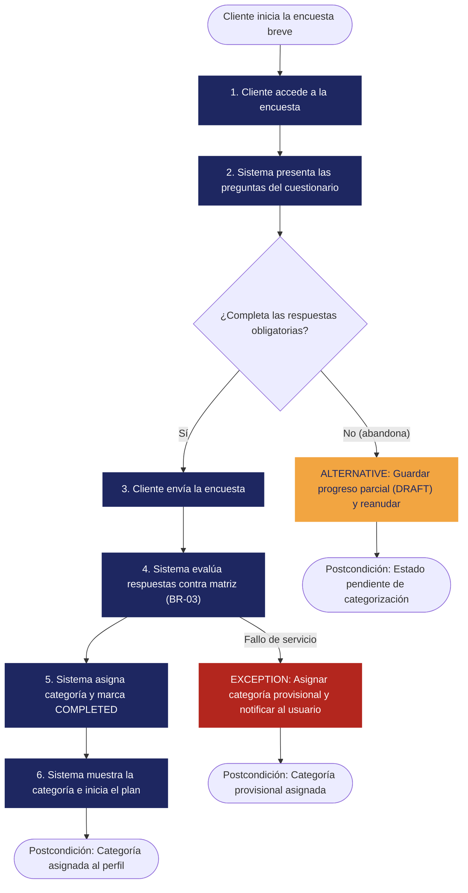

# REQ-01 — Categorización Inicial de Situación y Hábitos Financieros

| | |
|---|---|
| **Status** | Validated |
| **Team / Author(s)** | Sistema de Planificación Financiera |
| **Team / Author(s)** | Grupo 5 - Sistema de Planificación Financiera • Esteban David Suárez • Juan David Cortés • Joel Felipe Suárez • Kevin Facid Verjan|
| **Date** | 2026-10-08 |
| **Linked User Story / AC** | US-01, AC-01.1, AC-01.2, AC-01.3 |

---

## 1. Overview

**Requirement Statement**

> El sistema debe catalogar la situación y hábitos financieros del cliente mediante una encuesta breve para asignar una categoría de inicio en el plan.

**Type:** Functional
*(Filtro de Tecnología Perfecta: incluso disponiendo de velocidad infinita, memoria ilimitada, cero fallos y costo cero, el cliente aún necesita que el sistema evalúe sus respuestas e identifique su perfil/categoría inicial para personalizar su plan financiero. El comportamiento no desaparece.)*

**Source / Evidence**

> Ficha de Descubrimiento, Evidencia E-01 — Entrevistas con stakeholders y análisis de onboarding: "Los usuarios abandonan el proceso de registro si se les pide información contable o bancaria exhaustiva desde el primer día. Requieren una evaluación inicial rápida (menos de 3 minutos) que identifique su situación actual y les asigne un punto de partida claro."

**Need**

> Conocer mi perfil financiero de inicio de manera ágil sin tener que ingresar datos detallados o complejos.

**Value / Rationale**

> Permitir la personalización del plan financiero desde el primer momento, incrementando la tasa de conversión y retención durante el proceso de incorporación (onboarding) al reducir la fricción inicial.

---

## 2. Context — A Requirement Rarely Stands Alone

**Business Rule(s)**

> **BR-01** — Todo cliente registrado debe contar con una categoría de inicio asignada antes de generar o visualizar las recomendaciones de su plan financiero.
> **BR-02** — La encuesta debe estar limitada a un máximo de 10 preguntas para garantizar que el tiempo medio de respuesta no supere los 3 minutos.
> **BR-03** — En caso de que la puntuación obtenida se ubique exactamente en el límite o umbral entre dos categorías financieras, el sistema asignará por defecto la categoría de menor riesgo (más conservadora).

**Constraint(s)**

> La categorización debe resolverse internamente en la aplicación con base en las respuestas del usuario, sin depender de integraciones con APIs bancarias ni lectura de extractos externos en esta etapa inicial.

**Assumption(s)**

> Las respuestas autoreportadas por el cliente en la encuesta reflejan con suficiente fidelidad su realidad financiera para determinar una categoría de partida válida.

**Dependenc(ies)**

> Matriz o algoritmo de ponderación financiera definido por el área de producto/finanzas para mapear las combinaciones de respuestas a las categorías del plan.

**Risk(s)**

| Risk | Likelihood | Impact | Mitigation (optional) |
| --- | --- | --- | --- |
| El usuario responde la encuesta con datos imprecisos o apresurados | Media | Medio | Permitir al usuario reevaluar o ajustar su perfil financiero más adelante desde la configuración de su cuenta. |
| El usuario abandona la aplicación a mitad de la encuesta | Media | Alto | Guardar el progreso de cada pregunta respondida en estado borrador (`DRAFT`) para permitir reanudar el cuestionario sin perder información hasta su consolidación (`COMPLETED`). |

**Open Questions**

> Ninguna. *Tratada definiendo explícitamente en BR-03 la asignación de la categoría de menor riesgo por defecto en caso de puntuación en el límite exacto.*

---

## 3. Priority & Estimation

**Priority model used:** MoSCoW

**Priority assigned:**

> Asignamos **Must have**. La categorización inicial es el punto de entrada para toda la personalización del sistema. Sin esta categoría, la plataforma no puede determinar qué plan o recomendación mostrar al cliente. Consideramos **Should have**, pero se rechazó porque entregar un plan genérico sin categorización previa desvirtúa la propuesta de valor del producto.

**Estimate (confidence):** High

> La captura de datos mediante formularios y la aplicación de un modelo de puntuación parametrizado son patrones de desarrollo estándar y bien comprendidos por el equipo.

---

## 4. Representations — Requirement ≠ Representation

### 4.1 User Story

> Como **cliente nuevo**,
> quiero **completar una encuesta breve sobre mi situación y hábitos financieros**,
> para **recibir una categoría de inicio que personalice mi plan financiero**.

### 4.2 Acceptance Criteria

**Scenario 1 — Categorización exitosa tras encuesta completa**

> **Given** que el cliente se encuentra en la etapa de registro u onboarding
> **When** responde la totalidad de las preguntas obligatorias de la encuesta breve y la envía
> **Then** el sistema calcula su puntuación, transiciona el estado de la encuesta a completado (`COMPLETED`), le asigna su categoría de inicio y despliega la confirmación con el resumen de su plan.

**Scenario 2 — Abandono y reanudación de la encuesta (alternativo)**

> **Given** que el cliente ha respondido parcialmente la encuesta breve
> **When** sale de la aplicación o interrumpe la sesión y vuelve a ingresar
> **Then** el sistema mantiene sus respuestas en estado borrador (`DRAFT`) y le permite reanudar la encuesta desde la última pregunta respondida sin perder las respuestas previas.

**Scenario 3 — Error de cálculo de categoría (excepción)**

> **Given** que el sistema no puede procesar la regla de ponderación al enviar la encuesta
> **When** ocurre una falla en el servicio de categorización
> **Then** el sistema informa del error al usuario, asigna de forma provisional la categoría base "En Evaluación" y permite el acceso al panel principal.

### 4.3 Use Case

| Field |  |
| --- | --- |
| **Use Case name** | Catalogar Situación Financiera e Asignar Categoría |
| **Actor** | Cliente |
| **Goal** | Obtener una categoría de inicio personalizada para el plan financiero mediante la resolución de una encuesta breve |
| **Trigger** | El cliente inicia el proceso de configuración inicial del perfil financiero |
| **Precondition** | El cliente ha creado una cuenta y se ha autenticado en la plataforma |

**Main Flow**

1. El cliente inicia la encuesta breve de hábitos y situación financiera.
2. El sistema presenta las preguntas parametrizadas de la encuesta.
3. El cliente responde las preguntas obligatorias y confirma el envío.
4. El sistema evalúa las respuestas contra la matriz de ponderación financiera (aplicando BR-03 si aplica).
5. El sistema asigna y guarda la categoría de inicio en el perfil del cliente, marcando el registro como `COMPLETED`.
6. El sistema presenta al cliente su categoría asignada y el plan correspondiente.

**Alternative Flow**

> Encuesta incompleta / Abandono $\rightarrow$ El sistema guarda de forma automática las respuestas parciales con estado `DRAFT`. Al reingresar, el cliente es redirigido a la última pregunta pendiente para completar la encuesta.

**Exception**

> Error en el servicio de evaluación $\rightarrow$ El sistema notifica la falla temporal al usuario, asigna la categoría provisional "En Evaluación" y le permite continuar hacia la aplicación principal mientras se reintenta el procesamiento en segundo plano.

**Postcondition**

> El cliente cuenta con una categoría inicial asignada en su perfil y el plan ajustado a dicha categoría.

**Flow Diagram**

---

## 5. Traceability & Impact

**Backward — why does this requirement exist?**

> Evidencia E-01 $\rightarrow$ Necesidad N-01 ("conocer mi perfil financiero de inicio de manera ágil") $\rightarrow$ REQ-01.

**Forward — what will this affect?**

> REQ-01 $\rightarrow$ Diseño de interfaz (Componente de UI de Encuesta de Onboarding) y Lógica de Negocio (Módulo Evaluador de Perfiles Financieros) $\rightarrow$ Implementación $\rightarrow$ Pruebas (casos basados en AC-01.1, AC-01.2 y AC-01.3).

**Impact Analysis — if this requirement changes, what else might need to change?**

* [x] Business Rules
* [ ] Constraints
* [x] Dependencies
* [x] Risks
* [x] Acceptance Criteria
* [x] Estimate
* [ ] Priority
* [x] Future Design
* [x] Future Tests

> Si la estructura de la encuesta o la lógica de asignación de categorías cambia (ej. si se aumenta el número de preguntas o se requiere conexión bancaria directa), se verán afectadas las Reglas de Negocio (BR-02), la matriz de Ponderación (Dependencia), los Criterios de Aceptación, el Diseño de la interfaz de la encuesta y las Pruebas automatizadas asociadas.

---

## 6. Validation — Quality Gate

* [x] **Valid?** Sí — proviene directamente de la evidencia E-01 y la necesidad de reducir la fricción en el onboarding.
* [x] **Clear / Unambiguous?** Sí — la acción de clasificar hábitos y situación mediante encuesta para asignar categoría tiene una interpretación técnica clara.
* [x] **Atomic?** Sí — evalúa y asigna la categoría inicial; no se mezcla con el cálculo del presupuesto detallado ni con recomendaciones específicas.
* [x] **Necessary?** Sí — sin la asignación de categoría, el sistema no puede ofrecer un plan personalizado.
* [x] **Feasible?** Sí — realizable mediante lógica de formularios y reglas de puntuación sin infraestructura compleja externa.
* [x] **Verifiable?** Sí — comprobable mediante los criterios de aceptación AC-01.1 al AC-01.3.
* [x] **Consistent?** Sí — no entra en conflicto con otros requerimientos del sistema.
* [x] **Complete enough?** Sí — la regla de desempate en límites de puntuación quedó formalizada explícitamente en la regla de negocio BR-03.
* [x] **Traceable?** Sí — cada sección conecta con evidencia previa, reglas de negocio o criterios de aceptación específicos.
