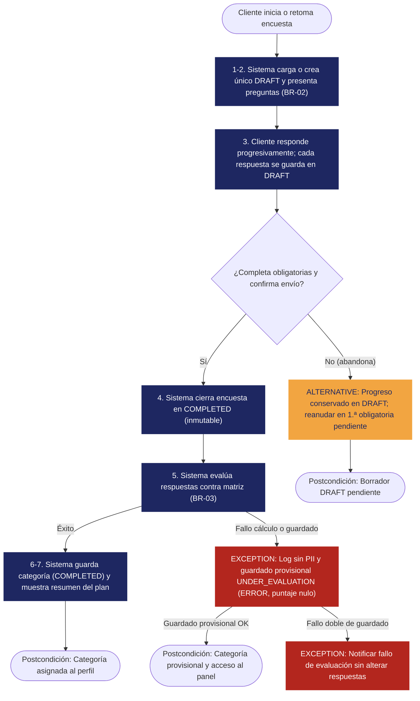

# REQ-01 — Categorización Inicial de Situación y Hábitos Financieros

| | |
|---|---|
| **Status** | Validated (alineado con Diseño 2) |
| **Team / Author(s)** | Grupo 5 — Sistema de Planificación Financiera • Esteban David Suárez • Juan David Cortés • Joel Felipe Suárez • Kevin Facid Verjan |
| **Date** | 2026-10-08 (revisado 2026-11-12) |
| **Linked User Story / AC** | US-01, AC-01.1, AC-01.2, AC-01.3 |

---

## 1. Overview

**Requirement Statement**

> El sistema debe catalogar la situación y hábitos financieros del cliente mediante una encuesta breve para asignar una categoría de inicio en el plan.

**Type:** Functional *(con restricciones no funcionales verificables de tiempo, precisión numérica, seguridad y privacidad)*  
*(Filtro de Tecnología Perfecta: incluso disponiendo de velocidad infinita, memoria ilimitada, cero fallos y costo cero, el cliente aún necesita que el sistema evalúe sus respuestas e identifique su perfil/categoría inicial para personalizar su plan financiero. El comportamiento no desaparece.)*

**Source / Evidence**

> Ficha de Descubrimiento, Evidencia E-01 — Entrevistas con stakeholders y análisis de onboarding: "Los usuarios abandonan el proceso de registro si se les pide información contable o bancaria exhaustiva desde el primer día. Requieren una evaluación inicial rápida (menos de 3 minutos) que identifique su situación actual y les asigna un punto de partida claro."

**Need**

> Conocer mi perfil financiero de inicio de manera ágil sin tener que ingresar datos detallados o complejos.

**Value / Rationale**

> Permitir la personalización del plan financiero desde el primer momento, incrementando la tasa de conversión y retención durante el proceso de incorporación (onboarding) al reducir la fricción inicial.

---

## 2. Context — A Requirement Rarely Stands Alone

**Business Rule(s) (Dominio)**

> **BR-01** — Todo cliente registrado debe contar con una categoría de inicio asignada antes de generar o visualizar las recomendaciones de su plan financiero.  
> **BR-02** — La encuesta debe estar limitada a un máximo de 10 preguntas activas para garantizar que el tiempo medio de respuesta no supere los 3 minutos.  
> **BR-03** — En caso de que la puntuación obtenida se ubique exactamente en el límite o umbral entre dos categorías financieras, el sistema asignará por defecto la categoría de menor riesgo (más conservadora).  
> **Invariantes del ciclo de encuesta:** Un cliente puede mantener a lo sumo una encuesta en estado `DRAFT` a la vez. Una vez confirmada y marcada en estado `COMPLETED`, la encuesta es inmutable: no puede volver a `DRAFT` ni aceptar modificaciones sobre sus respuestas.

**Constraint(s) y Criterios No Funcionales Verificables**

> * **Alcance funcional (Restricción):** La categorización debe resolverse internamente en la aplicación con base en las respuestas del usuario, sin depender de integraciones con APIs bancarias ni lectura de extractos externos en esta etapa inicial.
> * **Usabilidad / Tiempo (No funcional):** El cuestionario acotado por `BR-02` debe poder diligenciarse en menos de 3 minutos.
> * **Precisión numérica (No funcional):** El cálculo de puntajes y ponderaciones debe ejecutarse con aritmética decimal exacta (sin errores de redondeo por punto flotante).
> * **Seguridad y privacidad (No funcional):** Toda lectura o escritura debe restringirse al propietario autenticado sin revelar la existencia de recursos ajenos, y está prohibido registrar respuestas, puntajes o datos personales identificables (PII) en los logs de aplicación.

**Assumption(s)**

> Las respuestas autoreportadas por el cliente en la encuesta reflejan con suficiente fidelidad su realidad financiera para determinar una categoría de partida válida.

**Dependenc(ies)**

> Matriz o algoritmo de ponderación financiera, catálogo de opciones y umbrales numéricos definidos por el área de producto/finanzas para mapear las combinaciones de respuestas a las categorías del plan (`CONSERVATIVE`, `MODERATE`, `AGGRESSIVE`).

**Risk(s)**

| Risk | Likelihood | Impact | Mitigation |
| --- | --- | --- | --- |
| Acceso, divulgación o modificación no autorizados de los datos personales y respuestas financieras del usuario durante el diligenciamiento, procesamiento o almacenamiento de la encuesta, comprometiendo la confidencialidad, privacidad e integridad de la información. | Media | Alto | Obtener la identidad del usuario exclusivamente desde su sesión autenticada (nunca desde el cuerpo de la petición); validar propiedad en toda lectura y escritura de encuestas y perfiles rechazando recursos ajenos sin confirmar su existencia; garantizar la inmutabilidad de encuestas en estado `COMPLETED`; proteger la comunicación en tránsito mediante HTTPS/TLS; prohibir estrictamente el registro de respuestas, puntajes o PII en los logs de aplicación; y aplicar principio de mínimo privilegio en los permisos de acceso a datos. |

**Open Questions**

> Ninguna a nivel de comportamiento funcional (el desempate en umbrales quedó definido en `BR-03`). Los valores numéricos exactos de los umbrales y el catálogo de opciones por pregunta permanecen sujetos a la definición de producto/finanzas (Dependencia).

---

## 3. Priority & Estimation

**Priority model used:** MoSCoW

**Priority assigned:**

> Asignamos **Must have**. La categorización inicial es el punto de entrada para toda la personalización del sistema. Sin esta categoría, la plataforma no puede determinar qué plan o recomendación mostrar al cliente. Consideramos **Should have**, pero se rechazó porque entregar un plan genérico sin categorización previa desvirtúa la propuesta de valor del producto.

**Estimate (confidence):** High

> La captura progresiva de respuestas mediante formularios y la aplicación de un modelo de puntuación parametrizado son patrones estándar y bien comprendidos por el equipo.

---

## 4. Representations — Requirement ≠ Representation

### 4.1 User Story

> Como **cliente nuevo**,  
> quiero **completar una encuesta breve sobre mi situación y hábitos financieros**,  
> para **recibir una categoría de inicio que personalice mi plan financiero**.

### 4.2 Acceptance Criteria

**Scenario 1 — Categorización exitosa tras encuesta completa**

> **Given** que el cliente se encuentra en la etapa de onboarding con una encuesta en estado `DRAFT`  
> **When** responde la totalidad de las preguntas obligatorias y confirma el envío  
> **Then** el sistema transiciona la encuesta a estado `COMPLETED` (inmutable), calcula su puntuación con precisión decimal exacta aplicando `BR-03` si corresponde, le asigna su categoría de inicio (`CONSERVATIVE`, `MODERATE` o `AGGRESSIVE`) con estado de evaluación `COMPLETED` y despliega la confirmación con el resumen derivado de su plan.

**Scenario 2 — Abandono y reanudación de la encuesta (alternativo)**

> **Given** que el cliente ha respondido parcialmente la encuesta y cada respuesta ha sido guardada progresivamente en su único borrador (`DRAFT`)  
> **When** interrumpe la sesión o sale de la aplicación y vuelve a ingresar  
> **Then** el sistema conserva sus respuestas previas en estado `DRAFT` y le permite reanudar la encuesta ubicándolo en la primera pregunta obligatoria pendiente, sin perder el progreso guardado.

**Scenario 3 — Error de cálculo o persistencia de categoría (excepción)**

> **Given** que la encuesta ya fue confirmada en estado `COMPLETED` y ocurre una falla en el cálculo de la ponderación o en el guardado de la categoría definitiva  
> **When** el sistema procesa la evaluación de manera síncrona  
> **Then** registra únicamente el error técnico sin incluir respuestas, puntajes ni PII en los logs, asigna de forma provisional la categoría `UNDER_EVALUATION` ("En Evaluación") con estado de evaluación `ERROR` y puntaje nulo, informa la falla temporal al usuario y le permite acceder al panel principal. Si también falla el guardado del perfil provisional, el sistema notifica al usuario que no pudo completarse la evaluación sin exponer detalles internos.

### 4.3 Use Case

| Field | |
| --- | --- |
| **Use Case name** | Catalogar Situación Financiera y Asignar Categoría |
| **Actor** | Cliente |
| **Goal** | Obtener una categoría de inicio personalizada para el plan financiero mediante la resolución de una encuesta breve |
| **Trigger** | El cliente inicia o retoma el proceso de configuración inicial del perfil financiero |
| **Precondition** | El cliente ha creado una cuenta y se ha autenticado en la plataforma |

**Main Flow**

1. El cliente inicia la encuesta breve de hábitos y situación financiera (el sistema garantiza a lo sumo un borrador `DRAFT` activo por cliente).
2. El sistema presenta las preguntas activas parametrizadas del cuestionario (máximo 10, `BR-02`).
3. El cliente responde progresivamente las preguntas obligatorias; cada respuesta se valida y guarda individualmente mientras la encuesta permanece en `DRAFT`.
4. El cliente confirma el envío tras completar todas las preguntas obligatorias y el sistema marca la encuesta como `COMPLETED` (estado inmutable).
5. El sistema evalúa de forma síncrona las respuestas contra la matriz de ponderación financiera (aplicando `BR-03` si el puntaje coincide con un umbral).
6. El sistema asigna y guarda la categoría de inicio en el perfil financiero del cliente (`BR-01`) con estado de evaluación `COMPLETED`.
7. El sistema presenta al cliente su categoría asignada y el resumen derivado del plan correspondiente.

**Alternative Flow**

> Encuesta incompleta / Abandono → Cada respuesta respondida ya fue guardada progresivamente en el borrador único en estado `DRAFT`. Al reingresar, el sistema recupera el `DRAFT` del cliente con sus respuestas previas y lo posiciona en la primera pregunta obligatoria pendiente para completar la encuesta.

**Exception**

> Error en la evaluación o persistencia de categoría → Con la encuesta ya cerrada en estado `COMPLETED`, si falla el cálculo o el guardado de la categoría definitiva, el sistema registra un log técnico sanitizado (sin respuestas, puntajes ni PII), persiste el perfil provisional con categoría `UNDER_EVALUATION`, estado de evaluación `ERROR` y puntaje nulo, notifica la falla temporal al usuario y le permite continuar hacia el panel principal (sin reintento automático en segundo plano). Si también falla el guardado de la categoría provisional, el sistema informa al usuario que no fue posible completar la evaluación.

**Postcondition**

> La encuesta queda cerrada en estado `COMPLETED` (inmutable) y el cliente cuenta con una categoría inicial asignada en su perfil financiero (`CONSERVATIVE`, `MODERATE`, `AGGRESSIVE` o provisional `UNDER_EVALUATION`), salvo en el caso excepcional de fallo doble de persistencia.

**Flow Diagram**

---

## 5. Traceability & Impact

**Backward — why does this requirement exist?**

> Evidencia E-01 → Necesidad N-01 ("conocer mi perfil financiero de inicio de manera ágil") → REQ-01.

**Forward — what will this affect?**

> REQ-01 → Diseño Arquitectónico y Detallado (`docs/design/01_Architectural_and_Detailed_Design.md`) y Diseño de Interacción, Datos y Contratos (`docs/design/02_Interaction_and_Data_Design.md`) → Implementación → Pruebas (casos basados en AC-01.1, AC-01.2 y AC-01.3).

**Impact Analysis — if this requirement changes, what else might need to change?**

* [x] Business Rules
* [ ] Constraints
* [x] Dependencies
* [x] Risks
* [x] Acceptance Criteria
* [x] Estimate
* [ ] Priority
* [x] Future Design
* [x] Future Tests

> Si la estructura de la encuesta o la lógica de asignación de categorías cambia (ej. si se aumenta el número de preguntas o se requiere conexión bancaria directa), se verán afectadas las Reglas de Negocio (`BR-02`), la matriz de ponderación (Dependencia), los Criterios de Aceptación, el diseño de interacción y datos y las pruebas automatizadas asociadas.

---

## 6. Validation — Quality Gate

* [x] **Valid?** Sí — proviene directamente de la evidencia E-01 y la necesidad de reducir la fricción en el onboarding.
* [x] **Clear / Unambiguous?** Sí — el flujo progresivo `DRAFT`, la transición inmutable a `COMPLETED`, `BR-03` y el manejo síncrono de fallos tienen una interpretación única.
* [x] **Atomic?** Sí — evalúa y asigna la categoría inicial; no se mezcla con el cálculo del presupuesto detallado ni con recomendaciones específicas.
* [x] **Necessary?** Sí — sin la asignación de categoría, el sistema no puede ofrecer un plan personalizado.
* [x] **Feasible?** Sí — realizable mediante formularios con guardado progresivo y reglas de puntuación sin infraestructura compleja externa.
* [x] **Verifiable?** Sí — comprobable mediante los criterios de aceptación AC-01.1 al AC-01.3.
* [x] **Consistent?** Sí — alineado con `docs/design/02_Interaction_and_Data_Design.md` y `docs/code_style.md`.
* [x] **Complete enough?** Sí — la regla de desempate (`BR-03`), la unicidad de `DRAFT`, la inmutabilidad de `COMPLETED` y los escenarios de fallo están formalizados.
* [x] **Traceable?** Sí — cada sección conecta con evidencia previa, reglas de negocio, riesgos y artefactos de diseño específicos.
